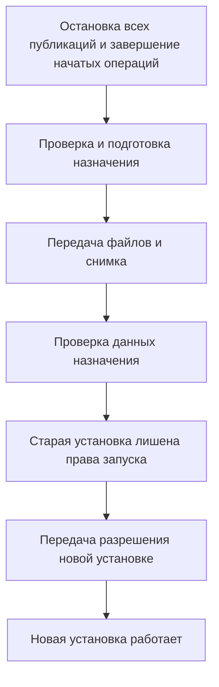

# Управляемый перенос приложения между компьютером и VPS

Дата: 25 октября 2026 года. Статус: архитектурное предложение; код и развёртывание не выполнялись.

Нормативная детализация для реализации находится в [общем ТЗ](web-platform-spec.md) и [протоколе переноса](web-platform-migration.md). При расхождении применяется эта детализация; данный документ сохраняет историю обоснования.

Пользователем выбран общий веб-интерфейс и Telegram Mini App на FastAPI с сохранением SQLite. Этот документ дополняет архитектуру управления публикациями механизмом планового переноса работающей системы в обе стороны.

## Решение

Предлагается раздел «Размещение и перенос» с мастером миграции. После команды начала переноса он останавливает публикации во всех каналах, подтверждает завершение начатых отправок, проверяет целевой компьютер, устанавливает совместимую версию программы, переносит данные и передаёт право запуска новой установке. Пользователь видит результат каждого этапа и открывает тот же набор публикаций на новом адресе. Заполнение профиля сервера само по себе публикации не останавливает; фактический перенос начинается отдельной явной командой.

Цель — сохранность подтверждённых данных, идентичности бота, порядка очереди, времён и истории при управляемой паузе на всё время операции. Пользователь выбрал остановку публикаций также на время подготовки назначения и передачи данных. Пауза поэтому включает установку и загрузку файлов, а не только финальное переключение. Если срок публикации попал в окно переноса, возможна задержка; её обработка задаётся до переключения.

Поддерживаемые направления первого выпуска: ПК → облако, облако → ПК и облако → облако. Первый серверный профиль: Ubuntu 24.04 LTS; стандартное сопровождение безопасности этой версии указано до мая 2029 года в [официальном цикле Ubuntu](https://ubuntu.com/about/release-cycle). Выбор версии означает целевой профиль разработки, а не уже выполненную проверку установщика.

Перед началом показывается сообщение: «На время переноса публикация всех постов во всех каналах будет остановлена. Начатые отправки завершатся; новые отправки, включая ручные, будут заблокированы. Очередь и настройки сохранятся. Работа возобновится после проверки новой установки». Сначала UI показывает «Останавливаем публикации»; «Все публикации остановлены» появляется только после проверки отсутствия активных отправок.

Рабочая SQLite находится на локальном постоянном диске активной машины. Пользователь с другого устройства обращается к API. Совместное открытие файла SQLite с ПК и VPS по сетевому пути не используется: SQLite отдельно описывает проблемы такого доступа, а WAL требует размещения процессов на одном хосте. [Сетевой доступ к SQLite](https://www.sqlite.org/useovernet.html), [ограничения WAL](https://www.sqlite.org/wal.html).

## Что подтверждено в текущем проекте

| Компонент | Наблюдение | Значение для переноса |
| --- | --- | --- |
| `app/local.py:78` | `backup_database()` использует SQLite Backup API и `quick_check` | Основа корректного снимка уже есть |
| `tests/test_local_runtime.py:98` | Есть проверка сохранения записей из WAL в резервной копии | Сценарий предусмотрен тестами; в этом анализе тесты не запускались |
| `app/queue/worker.py:92` | `stop()` прекращает дальнейшую работу цикла и ожидает текущие задачи | Полезно для завершения начатых отправок; общего режима миграции ещё нет |
| `app/services/job_service.py:790` | При восстановлении отправка с неизвестным результатом получает `uncertain_publish` | Эту защиту нужно сохранить при переносе |
| `app/runtime.py:23` | `InstanceLock` блокирует вторую копию в одной папке storage | Две машины с копиями базы он не защищает |
| `app/bootstrap.py:62` | Запуск связывает API новостей, polling, статистику и очередь | Нужны отдельные режимы проверки, ожидания активации и работы |
| `app/bootstrap.py:251` | Каналы обновляются из конфигурации при старте | Перезапуск после переноса не должен перезаписать настройки из БД устаревшей конфигурацией |
| `app/local.py:53` | Локальный режим создаёт секрет в памяти и соединяет worker с loopback API | Удалённому worker нужны постоянная регистрация и новый адрес |
| `app/services/model_selection.py` | Выбранная модель сохранена в файле и привязана к адресу LM Studio | Настройки относятся к машине AI-worker, их нельзя переносить механически |
| `docker-compose.yml`, `Dockerfile` | Уже есть контейнерный запуск и отдельные тома данных | Можно использовать как основу серверного выпуска, но готового установщика нового UI нет |
| `deploy/update.sh` | Скрипт обновляет установленный Linux-сервис, использует фиксированный путь БД и копирование файла | Это не мастер миграции; его нельзя без изменений применять к произвольной установке |

Дополнительно проверен установленный aiogram: стандартный polling запускает обработчики сообщений отдельными задачами. Остановка получения обновлений сама по себе не доказывает, что все ранее полученные сообщения сохранены. Перед финальным снимком требуется завершение обработчиков либо постоянный входящий журнал.

## Вид экрана

| Блок | Поля и поведение |
| --- | --- |
| Текущее размещение | «Этот компьютер» или имя сервера; адрес панели, версия приложения, активная роль и состояние |
| База и файлы | Фактический путь на активной машине, размер, число записей, объём обязательных медиа, последняя проверенная копия |
| AI | Зарегистрированный обработчик, машина, доступность и выбранная модель |
| Назначение | «Перенести на сервер», «Перенести на этот компьютер», «На другой сервер», сохранённые профили машин |
| Подключение к VPS | IP/имя, SSH-порт, пользователь, ключ либо пароль; при необходимости параметры повышения прав |
| Данные на целевой машине | Рекомендуемая папка; дополнительные поля для изменения каталогов приложения и данных |
| Внешний адрес | Проверенный HTTPS-адрес панели и Mini App, способ его подключения |
| План переноса | Объём передачи, необходимые настройки, ближайшие публикации, ожидаемая пауза и политика просроченных заданий |
| Действия | Настроить → Начать перенос → Остановка публикаций → Подготовка и передача → Проверка → Открыть панель |
| Результат | Активная машина, контрольные суммы и проверки, состояние старой установки, доступность обратного переноса |

Визуальный переключатель может выбирать желаемое размещение и открывать мастер. Текущее размещение меняется только после подтверждённого завершения операции. Переключение не должно мгновенно подменять `DATABASE_URL` или включать вторую копию.

Путь источника читается из активной установки автоматически. Выбор другого файла — отдельная операция импорта или восстановления с проверкой содержимого и принадлежности боту. Внешний URL сервера и путь SQLite на его диске показываются раздельно. Путь относится к выбранной машине, а не к устройству, на котором открыт браузер.

## Как определяется окружение

Авторитетный источник — профиль установки, созданный установщиком. Автоматически определяются ОС, архитектура, имя машины, свободное место, доступность необходимых процессов и сеть. Эти признаки помогают проверке, но публичный IP, Linux или обнаружение виртуальной машины не доказывают, что установка должна быть активным облачным сервером.

Разделяем два независимых свойства:

- **Назначение машины:** локальная установка, сервер, домашний AI-worker, устройство управления. Одна машина может совмещать роли.
- **Состояние основного приложения:** подготовлено, активно, завершает работу, перенесено, требует выяснения состояния.

У системы постоянный `deployment_id`, у каждой установки собственный `node_id`. У операции переноса есть `migration_id`, а у передачи управления — возрастающий номер поколения. Идентификаторы помогают связать журнал, копии и разрешение запуска. Сами числа в двух независимых SQLite не являются межмашинной блокировкой.

## Какой сервер поддерживаем

Для первой версии выбран существующий VPS/VDS с Ubuntu 24.04 LTS, SSH-доступом, постоянным диском и правами на установку компонентов. Автоматизировать установку на заранее определённом наборе систем реалистично; совместимость с произвольным хостингом потребует отдельных адаптеров.

Логин от сайта хостинг-провайдера не равнозначен SSH-доступу к машине. Если панель выдаёт SSH-реквизиты — используем их. Создание самой виртуальной машины, управление её питанием или DNS через API провайдера — отдельная интеграция с его API-ключом. Обычный тариф для размещения сайтов может не разрешать постоянный Python-процесс, необходимые пакеты и дисковое хранение; мастер проверяет нужные возможности до начала переноса.

SSH поддерживает вход по ключу; для автоматического обслуживания предпочтителен отдельный ключ. Пароль также можно поддержать для первоначального подключения. [Документация OpenSSH в Ubuntu](https://ubuntu.com/server/docs/how-to/security/openssh-server/).

Рекомендуемый серверный выпуск — закреплённый образ приложения, Docker Compose, постоянный каталог данных и HTTPS-прокси. Docker описывает Compose как вариант размещения на одном сервере; данные следует хранить вне заменяемого слоя контейнера. [Compose в production](https://docs.docker.com/compose/how-tos/production/), [постоянные тома](https://docs.docker.com/engine/storage/volumes/).

Windows-установка может оставаться обычным Python-приложением. Переносятся данные, а на целевой ОС устанавливается совместимая сборка; Windows-окружение Python не копируется на Linux. Сам формат SQLite переносим между архитектурами. [Переносимость SQLite](https://www.sqlite.org/onefile.html).

## Что переезжает

| Содержимое | Правило |
| --- | --- |
| SQLite | Полный согласованный снимок со всеми ID, связями, состояниями, настройками и историей |
| Расписание | `queue_position`, `scheduled_at`, `next_publish_at`, интервалы, паузы и отложенные повторы сохраняются |
| Результаты отправок | Записи публикаций и Telegram message ID сохраняются; они нужны для истории и предотвращения повторов |
| Медиа | Все локальные файлы, необходимые действующим черновикам и очереди; дополнительные архивы — по выбранной политике |
| Настройки | Общие параметры сохраняются; пути, адреса и порты преобразуются под целевую установку |
| Секреты приложения | Передаются защищённо и только компонентам, которым они нужны |
| Релиз | Фиксируются версия программы, версия схемы БД и состав сборки |
| Входящие команды | Сохранённый журнал приёма и идентификаторы обработанных запросов переходят вместе с БД |
| AI | Сохраняется связь с конкретным worker и его настройками; веса модели по умолчанию остаются дома |

Перенос выполняется между совместимыми выпусками. Смена размещения и обновление схемы БД — отдельные операции. В текущей папке есть незакоммиченные изменения, поэтому развёртывание просто последнего `main` не гарантировало бы совпадение программы. Для будущего мастера нужен воспроизводимый выпуск с идентификатором сборки.

Для данных предлагается общий каталог с SQLite, медиа, миниатюрами и служебными файлами. Новые ссылки на собственные медиа хранятся как идентификатор или путь относительно каталога данных. Старые абсолютные Windows-пути преобразуются по известной структуре; отсутствующий файл не объявляется восстановленным. Недостающий обязательный файл черновика должен быть восстановлен либо явно разобран до переключения. Отсутствие уже удалённого исторического оригинала показывается в отчёте и не обязательно блокирует перенос.

Секреты конкретной машины — SSH-ключи управления, разрешение её запуска, локальные параметры AI — отделяются от переносимого набора бизнес-данных. Иначе восстановление старого архива могло бы восстановить и устаревшее право публикации.

## Контроллер переноса

Вводим отдельный менеджер установки и миграции. На ПК он входит в локальный launcher/служебный модуль, а на VPS выполняет ограниченные административные операции через SSH или установленный агент. Этот процесс продолжает работать, когда основная программа остановлена.

Длительная миграция имеет постоянный журнал вне переносимой рабочей БД. UI получает ID операции и отображает прогресс; закрытие вкладки не прерывает перенос. Шаги повторяемы: повтор команды установки, передачи файла или проверки не создаёт новую установку и не запускает второй экземпляр.

Для первого выпуска управление переносом может выполняться локальным модулем через SSH в обе стороны. Если запускать обратный перенос из Mini App на телефоне, зарегистрированный локальный модуль должен быть включён и доступен через исходящее защищённое соединение. Браузер сам не устанавливает программу на Windows, а облачный сервер не может рассчитывать на входящее подключение к домашнему ПК за роутером.

При переносе облако → облако управляющий модуль может работать на исходном VPS отдельной службой и продолжать работу при остановленном публикаторе. Он передаёт пакет напрямую назначению, без обязательной промежуточной загрузки на ПК. После подтверждения переноса журнал и управление новой установкой доступны на целевом узле; старый сервер можно отключать после завершения операции. Это тот же протокол передачи управления с произвольной парой зарегистрированных узлов. Отсутствие доступа к источнику не превращает плановый перенос в безопасный автоматический failover.

Учётные данные установки обрабатывает контроллер, а не обычная операция редактирования публикации. Они не попадают в журналы, SQLite контента или браузерное постоянное хранилище. Для первоначального SSH-подключения проверяется ключ сервера; установка ограничивается выбранной машиной и выделенными каталогами. Программа публикации работает с обычными правами, отдельно от необходимых установщику административных прав.

## Протокол планового переноса

### 1. Общая остановка перед подготовкой

После явного начала переноса включается отдельный запрет всех отправок, включая ручные и запланированные. Он проверяется при выдаче работы и непосредственно перед отправкой, действует для всех интерфейсов и каналов и не может обходиться `force_publish`. Уже отправленный Telegram-запрос не обрывается ради снятия блокировки: ожидается его результат; неизвестный результат остаётся отдельным состоянием. Режим сохраняется независимо от пользовательских пауз каналов и переживает перезапуск.

Перед подготовкой назначения выполняется завершение текущих операций, описанное ниже. При ошибке мастера публикации остаются остановленными до подтверждённого возобновления разрешённого узла. Блокировка не заменяет последующую проверку остановки источника и передачу права запуска.

### 2. Проверка и подготовка назначения

Проверяем SSH, права, ОС, архитектуру, свободное место с учётом промежуточной копии, совместимость релиза и доступность Telegram и источников с нового IP. Отдельно проверяем HTTPS-адрес и будущую связь с AI-worker. Если на целевой машине уже есть установка или данные, определяем их принадлежность; существующая база не перезаписывается молча.

Устанавливаем ту же версию программы в неактивном режиме. Он допускает проверки конфигурации и чтение данных, но не включает отправку, приём Telegram-команд, фоновые записи, автоматическое восстановление очереди или синхронизацию каналов из конфигурации. Полный текущий `bootstrap()` для такой проверки использовать без разделения нельзя.

Публикации исходного приложения уже остановлены. Крупные файлы передаются с проверяемым прогрессом; очистка нужных файлов блокируется на время переноса. Управляющая служба и отображение прогресса продолжают работать.

### Завершение текущих операций

Контроллер включает общий режим обслуживания для всех точек входа. Новые публикационные задания и новые AI-задачи не выдаются исполнителям. Веб-правки временно закрываются; уже принятые запросы завершаются и сохраняются. Пользовательские паузы каналов сохраняются отдельно: их нельзя использовать как единственный механизм остановки, потому что ручная публикация сейчас обходит паузу.

Уже начатые отправки дожидаются результата. Обработчики входящих сообщений, объединение альбомов, фоновые записи статистики, изменения моделей и очистка файлов также должны завершиться либо перейти в контролируемое состояние. После этого фиксируется отсутствие выполняющихся записей и исходящих отправок.

Для длительной AI-генерации предпочтительно дождаться завершения. Альтернатива — согласованно остановить задачу, аннулировать прежнюю выдачу worker и сохранить её для повторного выполнения после переноса. Это не восстановление генерации с середины: запрос к модели может потребоваться выполнить заново. Поздний ответ старого worker не должен изменить новую БД, а служебный перенос не должен сам по себе исчерпывать пользовательские попытки.

### 3. Снимок и передача данных

После остановки всех записывающих компонентов создаётся окончательная SQLite-копия через Backup API. Простого копирования одного активного `.db` недостаточно в режиме WAL: часть подтверждённых данных может находиться в дополнительном журнале. [SQLite Backup API](https://www.sqlite.org/backup.html), [WAL как часть состояния БД](https://www.sqlite.org/wal.html#the_wal_file).

Пакет содержит снимок БД, обязательные медиа, подготовленные настройки и манифест: идентификаторы системы и операции, версии программы и схемы, контрольные суммы, перечень файлов и время создания. Все данные снимаются с одной остановленной версии состояния. Предварительная копия, сделанная во время работы, не заменяет финальный снимок.

Пакет загружается в новую временную папку. Проверяются целостность SQLite, связи, количество и идентификаторы записей, очередь и расписание, контрольные суммы медиа и конфигурация. После проверки набор данных устанавливается целиком; не смешивается с прежними файлами базы, WAL или media другой установки. Источник и резервная копия сохраняются.

### 4. Передача управления

Источник получает постоянное состояние «перенесено» в конфигурации узла вне переносимой БД. Отключаются его автозапуск в активной роли и политика автоматического перезапуска старого процесса. Проверяется фактическая остановка. Обычный запуск старого ярлыка после этого открывает информацию об активной установке или запускает только домашний worker.

Контроллер сохраняет решение о передаче в своём журнале и выдаёт назначению разрешение активации, связанное с конкретным узлом, поколением и проверенным снимком. Назначение сохраняет это разрешение до начала обработки. Повторный запрос активации той же операции возвращает её текущее состояние.

Только после этого включаются публикационная очередь и приём Telegram-команд на новой машине. Две копии файла SQLite и два локальных lock-файла не обеспечивают взаимного исключения. Также нельзя использовать конфликт polling как защиту от двойной отправки: ограничение одного polling-процесса касается получения обновлений. [Правило aiogram](https://docs.aiogram.dev/en/latest/dispatcher/long_polling.html).

Если источник недоступен и его остановка не подтверждена, плановая миграция не активирует назначение. Если ответ на активацию назначения потерян, источник остаётся отключённым до выяснения состояния. Для автоматического переключения при сетевых разрывах потребовались бы внешний авторитет владения и техническое отключение старого отправителя либо проверка разрешения на самом пути отправки. Копируемый флаг в SQLite этой гарантии не даёт.

Эти гарантии относятся к установкам, запущенным через предусмотренный менеджер. Произвольно запущенный старый код с копией токена не подчиняется новой системе управления; такой запуск нельзя считать поддерживаемым способом восстановления.

### 5. Переключение адресов и подтверждение результата

Панель показывает новое активное размещение. Домашний worker переключается на новый API с собственной постоянной учётной записью. Старый API отказывает изменяющим запросам и сообщает новый адрес; он не продолжает независимо принимать правки.

Для Mini App предпочтителен стабильный HTTPS-домен. До переноса проверяются домен, сертификат и маршрут к назначению. При изменении DNS учитывается время обновления адресов; для старых клиентов допустим переход к новому адресу, но не запись в старую базу. Если меняется сам URL, обновляется кнопка приложения и подключения клиентов. Неудача обновления кнопки после активации не является основанием запускать старую базу.

Возврат на полностью локальный HTTP-адрес сохраняет браузерную панель на ПК, но для дальнейшего использования Mini App нужен HTTPS-доступ к этому ПК. Этот выбор мастер показывает до переноса. Внешние адреса и маршрутизация входят в план, а не считаются автоматическим следствием загрузки БД.

## Сохранность входящих данных

Telegram подтверждает обновление при следующем `getUpdates` с более высоким offset; необработанные обновления хранятся не более 24 часов. Следовательно, нельзя полагаться только на Telegram для восстановления уже полученного сообщения после остановки процесса. [Получение обновлений](https://core.telegram.org/bots/api#getting-updates), [подтверждение offset](https://core.telegram.org/bots/api#getupdates).

Для обещания сохранности принимаемых материалов предлагается входящий журнал: сначала сохраняется update с уникальным ID, затем подтверждается получение, затем выполняется операция приложения. Повторная доставка сверяется с журналом. На момент переноса либо все принятые действия завершены, либо их записи входят в переносимую БД. Аналогично сохраняются ключи повторяемых HTTP-команд.

Незаконченные чат-мастера сейчас находятся в памяти. Для бесшовного продолжения их потребуется сохранять либо заменить постоянными черновиками. Неотправленный текст в поле браузера серверу неизвестен: перед режимом обслуживания UI должен завершить автосохранение и показать результат. Одно лишь копирование базы не переносит несохранённое содержимое экрана.

## Расписание и пределы непрерывности

Сохраняются все даты UTC и выбранный часовой пояс `Asia/Vladivostok`. Настройки часов новой машины проверяются. Интервал не начинает отсчёт заново только из-за переезда: переносится фактическое `next_publish_at`, а не заново вычисляется от времени установки.

Мастер предлагает окно между ближайшими публикациями. По выбранному пользователем правилу отправки остановлены на всё время операции, включая подготовку и передачу крупных файлов. Продолжительность остановки оценивается по этапам; фиксированную длительность до проверки объёма и скорости передачи обещать нельзя.

Для заданий, точное время которых прошло во время переноса, политика задаётся в плане. Предлагаемый вариант по умолчанию — сохранить их и отправлять при первой возможности с ограничением темпа; интерфейс явно показывает задержку. Перенос дат или пропуск — отдельный выбор пользователя. Обычная очередь сохраняет интервалы. Ограничение темпа восстановления просроченных точных публикаций — новая настройка миграции; оно не должно незаметно менять обычную семантику точных слотов.

Публикация в Telegram и запись её результата в SQLite не являются одной транзакцией. Если сообщение ушло, а подтверждение потерялось, новый сервер не может достоверно определить результат только по базе. Сохраняется `uncertain_publish` и проверка канала перед повтором. Плановое ожидание завершения отправок уменьшает это окно, но не создаёт абсолютной гарантии единственной отправки при любом сбое.

## Обратный перенос и откат

| Ситуация | Действие |
| --- | --- |
| Назначение не подготовилось; источник ещё работает | Завершить неудачную попытку, сохранить работу источника |
| Копирование или проверка не прошли после остановки | Возобновить источник только если назначение гарантированно не получило право активации |
| Разрешение активации выдано, ответ потерян | Проверить журнал и назначение; до выяснения не запускать источник |
| Назначение работает и принимало изменения | Выполнить новый обратный перенос его актуальной БД и файлов |
| Сервер полностью потерян | Отдельное аварийное восстановление из последней копии с проверкой возможных потерянных изменений и неопределённых отправок |

После недели работы в облаке локальная прежняя база устарела. Простое включение её снова способно повторить уже опубликованные задания и потерять новые. «Перенести обратно» всегда берёт снимок с текущей активной машины. Старый локальный набор сохраняется отдельно и заменяется целым проверенным набором из облака.

Домашний компьютер должен быть включён и иметь достаточно места. Его локальный модуль получает данные исходящим подключением либо сам скачивает их по SSH. При запуске переноса с телефона приложение может показать «Ожидаем локальный компьютер»; оно не может восстановить выключенный ПК одним изменением настройки в облаке.

## Разделение приложения и AI

Предлагаемый обычный облачный режим: API, веб-панель, SQLite, медиа и публикация находятся на VPS; модель и AI-worker — на домашнем компьютере. Настройка размещения основного приложения независима от настройки AI.

Переносятся обработанные материалы, поэтому уже подготовленная очередь может публиковаться без домашнего компьютера. Новые генерации ждут его включения. Чтобы это работало для всех сценариев, перевод названий тоже нужно завершать до автономной публикации или явно задавать допустимый резерв; текущая очередь умеет обращаться к переводу во время обработки задания.

Текущий домашний worker уже поддерживает опрос удалённого API, но локальный launcher использует временный секрет. После переезда нужна регистрация worker, отзыв старой выдачи задач и сохранённый адрес нового API. Каталог моделей, выбор модели и перевод названий нужно включить в этот протокол, как описано в предыдущем архитектурном решении. LM Studio остаётся доступен локальному worker; его порт не требуется открывать наружу.

Перенос самих моделей на GPU-сервер — дополнительный профиль размещения с отдельной проверкой ресурсов, объёма файлов и совместимости. Он не должен автоматически включаться при выборе обычного VPS для публикаций.

## Порядок реализации

1. В основу веб-версии заложить общий каталог данных, управляемый жизненный цикл, постоянные черновики, версии схемы, переносимые ссылки на медиа и постоянный входящий журнал.
2. Добавить проверяемый экспорт/импорт полного набора данных и пассивный режим запуска. Это позволит сначала проверить перенос без автоматической настройки VPS.
3. Добавить менеджер установки с журналом, профилями узлов, запретом запуска перенесённой копии и проверками передачи управления.
4. Поддержать Ubuntu 24.04 LTS и автоматическую установку по SSH; добавить мастер с графическим прогрессом в настройки.
5. Проверить переносы ПК → VPS, VPS → ПК и VPS → VPS с сохранением истории и расписания, включая работу AI дома.
6. Расширять список ОС и провайдеров после проверки первого сценария. Создание виртуальных машин и автоматический аварийный failover рассматриваются отдельно.

## Критерии приёмки

Испытания выполняются на копии БД и тестовом канале. Проверяется совпадение ID и содержимого заданий, настроек каналов, очереди, точных дат, результатов отправок и необходимых файлов. Дополнительно проверяются:

- обрыв передачи с последующим продолжением;
- выключение контроллера на каждом этапе и восстановление его журнала;
- перезапуск старой машины после успешного переноса;
- потеря ответа на активацию назначения;
- недостаток диска, несовместимая версия и неподходящий сервер;
- активная публикация и незавершённая AI-задача в начале миграции;
- поздний ответ прежнего worker и повтор Telegram update;
- публикация, срок которой попал в окно остановки;
- обратный перенос после новых публикаций и правок в облаке;
- перенос между двумя VPS с прямой передачей данных;
- невозможность ручной отправки из любого интерфейса во время общей остановки;
- восстановление графического прогресса после обновления страницы;
- недоступность домашнего AI при работающей серверной очереди;
- сохранение неизвестного результата отправки без автоматического повтора.

SQLite подходит для одной активной установки на ПК или VPS. Масштабирование нескольких независимых пишущих серверов потребует другого решения хранения и координации; наличие FastAPI само по себе это ограничение не снимает. Для описанного планового переезда такая инфраструктура не требуется.

## Общий интерфейс прогресса

Для миграции, импорта, загрузки медиа, перевода и подготовки новостей применяется единая модель фоновой операции: ID, список этапов, текущий этап, состояние, сообщение, время начала, последнее обновление, результат и доступные действия. Измеримый этап дополнительно содержит выполненный объём, общий объём и единицу измерения.

В интерфейсе завершённые этапы отмечаются галочкой, текущий — индикатором работы, будущие — спокойным контуром. Отдельно различаются «работает», «ожидает ответ сервера», «ожидает доступный AI», «требует действия», «ошибка» и «завершено». Один вращающийся индикатор без объяснения недостаточен.

Для передачи файлов отображаются реальные байты, число файлов и процент именно передачи. Для AI и ожидания ответа сервера показываются описание этапа, прошедшее время и актуальность последнего сигнала; выдуманный процент готовности не используется. Прогноз оставшегося времени появляется только при наличии достаточных измерений. Ошибка оставляет видимыми выполненные шаги и точку остановки.

Операция и её прогресс сохраняются сервером. Обновление страницы или закрытие Mini App не отменяет работу. Повторный вход восстанавливает состояние по ID. Кнопки остановки, повтора и возобновления доступны только в тех состояниях, где они безопасны. У миграции предупреждение об остановленных публикациях остаётся видимым до проверенного завершения либо отмены с восстановлением исходной установки.
