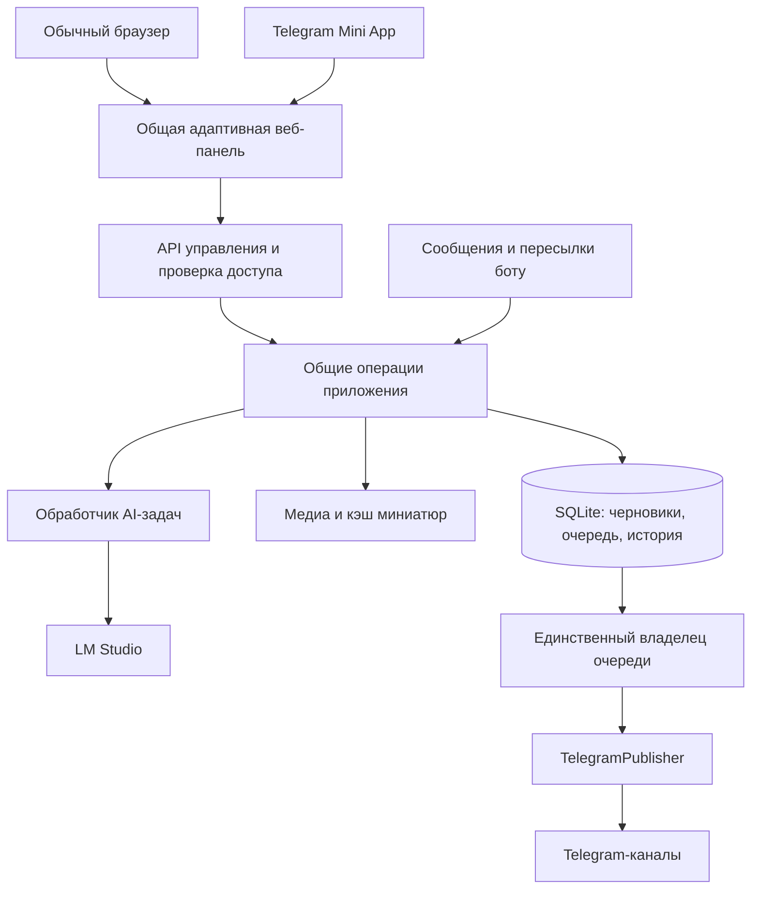

# Архитектура управления публикациями через веб-интерфейс и Telegram Mini App

Дата анализа: 25 октября 2026 года. Статус: предлагаемое решение, реализация не начата.

На основе обсуждения подготовлено [нормативное ТЗ для реализации](web-platform-spec.md) с контрактами, протоколом переноса, макетами и приёмкой. При расхождении требований действует ТЗ; этот документ сохраняет архитектурное обоснование.

После обсуждения пользователь выбрал общую веб-панель и Telegram Mini App, FastAPI и существующую SQLite. Предложение по управляемому переносу между ПК и VPS, включая обратный перенос, описано в `docs/deployment-migration-architecture.md`.

Рекомендация: создать одну адаптивную веб-панель и единый API управления на основе существующих Python-сервисов. Первое развёртывание — на текущем Windows-компьютере рядом с LM Studio. Telegram Mini App подключать как дополнительный способ открытия той же панели, когда понадобится управление с телефона. Если мобильный доступ нужен сразу, начать с общей панели и HTTPS-доступа, сохранив эту же архитектуру.

Предположение для выбора первого этапа: основной редактор работает с собственного компьютера; круглосуточная публикация при выключенном компьютере пока не является обязательным требованием. Если это требование появится, предпочтительным станет серверное развёртывание с домашним AI-worker.

## Основания и границы анализа

Проверены текущие файлы рабочей папки, модели SQLite, создание черновиков, редакторы, планировщик, публикация, восстановление, обработчик новостей, выбор модели и запуск приложения. База открывалась только для чтения. Ограничения Mini Apps проверены по официальной документации Telegram.

Это архитектурный анализ: запуск бота, публикация в каналы, генерация через LM Studio и проверка нового UI на устройствах не выполнялись. Документация проекта сопоставлена с кодом и фактическими данными, поэтому её старые сведения о состоянии очереди не приняты за текущие.

| Объект | Состояние на момент чтения |
| --- | --- |
| Пользователи | 1 |
| Каналы | 2, оба включены; интервал каждого — 2 часа |
| Задания публикации | 60: 58 с изображениями, 2 новостных |
| Статусы заданий | 9 завершённых, 50 отменённых, 1 ожидает подтверждения |
| Активная очередь публикаций | Нет заданий в очереди, по расписанию или в процессе отправки |
| Задачи обработки новостей | 4: 2 завершены, 1 отменена, 1 завершилась ошибкой |
| История публикаций | 9 записей |
| Медиа после публикации | 12 записей; по 14 различным сохранённым локальным путям файлов сейчас нет |
| Формат сохранённых альбомов | Все 58 заданий с изображениями используют прежний формат без полного `artwork_album.catalog` |

Текущая настройка удаляет файлы после успешной публикации. Отсутствующий файл в истории не означает, что исчезла сама публикация в Telegram. Однако новая панель не сможет автоматически считать такую запись готовым локальным изображением.

## Что уже можно использовать

| Часть | Реализация | Решение |
| --- | --- | --- |
| Источники изображений | `IngestService`, providers | Сохранить извлечение данных; принимать структурированные поля вместо разбора чат-команды |
| Черновики и очередь | `JobService`, SQLite | Сохранить задания, ID, состояния и историю |
| Выбор кадров | `AlbumEditor`, `app/domain/album.py` | Использовать существующий каталог и проверку изменений |
| Подписи и новости | `CaptionService`, `NewsRenderService`, translation services | Вынести общий результат подготовки текста для обоих интерфейсов |
| Обработка новостей | `NewsSubmissionService`, `NewsTaskService`, `HomeNewsWorker` | Сохранить очередь, выдачу задач worker и возврат результата |
| Публикация | `WorkerPool`, `TelegramPublisher` | Сохранить отправку через Telegram и обработку неопределённого результата |
| Модели | `ModelSelection`, `LMStudioModels` | Подключить каталог и выбор модели к новому API |
| Каналы и диагностика | `ChannelStatsService`, `HealthService` | Выдавать данные панели; обращения к Telegram остаются серверными |

Система уже содержит подходящую основу. Основная работа — добавить API, полноценный UI и отделить оставшиеся зависимости от чат-сообщений.

## Где потребуется переработка

1. **Обработчики Telegram содержат часть сценариев приложения.** В `app/bot/router.py` 2473 строки. Например, изменение тегов около строки 2307 выполняет запись в БД прямо из обработчика. Создание нескольких черновиков, проверку повторов, изменение тегов и запуск очереди нужно собрать в общие операции. Telegram и HTTP вызывают одинаковые операции.
2. **Предпросмотр связан с отправкой сообщений.** `PreviewService.send()` скачивает временные файлы, отправляет их в чат и удаляет. Даже `caption()` может вызвать перевод и запись результата. Панели нужны отдельные подготовка текста, получение медиа и отображение. Получение готового предпросмотра должно быть быстрым чтением; перевод — явной фоновой задачей.
3. **Запуск связан с Telegram polling.** `Application.run()` в `app/bootstrap.py:62` запускает очередь, статистику и обработку сообщений вместе. Нужен общий жизненный цикл приложения, в котором веб-сервер и Telegram являются подключаемыми интерфейсами. Закрытие вкладки не останавливает очередь.
4. **Существующий API имеет другое назначение.** `NewsApiServer.create_app()` в `app/news/api.py:58` предоставляет выдачу задач worker, прогресс, завершение, ошибку и здоровье. API управления публикациями, каналами и медиа ещё нет. Секрет worker нельзя использовать как браузерную авторизацию.
5. **Пользователь и уведомления привязаны к Telegram.** В `User` обязателен Telegram ID; в `NewsTask` обязателен `origin_chat_id`. Для локальной панели можно сначала сопоставить подтверждённую локальную сессию существующему администратору. Общим операциям передавать внутренний ID пользователя; адрес Telegram-уведомления сделать необязательным. Выделять отдельную систему ролей для одного администратора необязательно.
6. **Проверка доступа находится в Telegram middleware.** Веб-запросы должны отдельно проходить аутентификацию и проверку разрешений. Скрыть кнопку или знать ID задания недостаточно.
7. **Сохранение данных распределено.** Черновики и очередь находятся в SQLite; состояние незаконченного чат-мастера — в `MemoryStorage`; выбранная модель — в `storage/lmstudio-model.json`. Постоянные веб-черновики должны сохраняться сервером, а незаконченный ввод — явно восстанавливаться или помечаться как несохранённый.
8. **Настройки канала могут перезаписываться при запуске.** `_sync_channels()` в `app/bootstrap.py:251` обновляет из конфигурации адрес, название, режим, шаблон и другие поля. После добавления форм настройки SQLite должна стать источником этих изменяемых значений, а конфигурация — способом первоначального заполнения или явно запрошенного импорта.
9. **Миниатюры рассчитаны на чат.** Сейчас `AlbumThumbnails` собирает лист из девяти изображений. Веб-редактору нужны отдельные миниатюры с постоянными идентификаторами и кэшем, чтобы выбирать и перетаскивать кадры.

## Что представляет собой Telegram Mini App

Это собственный веб-интерфейс, который открывается внутри Telegram. В нём можно построить формы, таблицы, редактор альбома и календарь. Telegram предоставляет способы запуска и интеграцию с оформлением клиента; поддерживается полноэкранный режим. Возможность таких интерфейсов подтверждается [официальным описанием Mini Apps](https://core.telegram.org/bots/features#mini-apps).

Для нашего проекта предлагается кнопка «Управление» в личном чате бота. Она открывает ту же панель, которая доступна в обычном браузере. Кнопка настраивается через BotFather либо `setChatMenuButton`. Для обычного рабочего окружения адрес Mini App должен использовать HTTPS. См. [MenuButtonWebApp](https://core.telegram.org/bots/api#menubuttonwebapp) и [WebAppInfo](https://core.telegram.org/bots/api#webappinfo).

На сервере проверяем подпись `initData`, свежесть `auth_date` и затем Telegram ID по разрешённым администраторам. `initDataUnsafe` не является доказательством личности. Ограниченный `sendData` передаёт до 4096 байт, закрывает окно и доступен только при запуске через кнопку обычной клавиатуры; для рабочего редактора выбираем собственный HTTP API. [Документация и проверка данных](https://core.telegram.org/bots/webapps#validating-data-received-via-the-mini-app).

Не закладываем запуск через меню вложений: в рабочем окружении эта интеграция ограничена крупными рекламодателями. Для нашей кнопки в чате она не нужна. Mini App по прямой ссылке также не получает доступ к чтению истории чата. Пересылку материалов удобно сохранить через существующего бота. [Способы запуска и ограничения](https://core.telegram.org/bots/webapps#implementing-mini-apps).

Веб-редактор освобождает интерфейс управления от ограничений чат-кнопок. Публикация в канал по-прежнему проходит через Bot API и должна учитывать права бота, форматы файлов и правила выбранных методов отправки. Для сохранения нынешнего поведения применяются существующие проверки подписи и групп медиа. Перенос UI сам по себе их не меняет.

## Интерфейс и место работы сервера — разные решения

Mini App не размещает Python-программу или базу на стороне Telegram. Устройство открывает веб-адрес и должно иметь сетевой доступ к серверу приложения. `localhost` на телефоне означает сам телефон, а не домашний компьютер.

| Схема | Где работают API, база и очередь | Удалённый доступ | Выключен домашний ПК | Сложность |
| --- | --- | --- | --- | --- |
| Локальная панель | Windows рядом с LM Studio | Изначально только этот ПК | Панель и публикация недоступны | Наименьшая |
| Панель и Mini App через HTTPS-туннель | Тот же Windows-компьютер | Браузер или Telegram с телефона через опубликованный адрес | Сервер недоступен | Средняя |
| Панель и Mini App на VPS, AI дома | API, SQLite и публикация на сервере; AI-worker дома | Через постоянный HTTPS-адрес | Редактирование и подготовленная очередь работают; AI ждёт ПК | Наибольшая |

**Локальная панель.** Один запуск поднимает Python-приложение и открывает браузер. Домены и внешний хостинг для этого режима не требуются. Интерфейс хорошо подходит для большого экрана, массовых операций и редактирования альбомов. Выключение самого приложения или сон компьютера останавливают обработку.

**Mini App с домашним сервером.** Добавляется стабильный HTTPS-адрес, направленный через туннель к приложению. Например, Cloudflare Tunnel устанавливает исходящее соединение и не требует публичного IP домашней машины. Это подтверждено [документацией Cloudflare](https://developers.cloudflare.com/cloudflare-one/networks/connectors/cloudflare-tunnel/). Конкретного провайдера нужно выбирать с проверкой доступности в используемых сетях; такой вариант добавляет зависимость от туннеля. Через него публикуются только интерфейс и защищённый API приложения, а LM Studio остаётся локальным.

**Постоянный сервер и домашний AI-worker.** В проекте уже есть основа: worker сам запрашивает задания на сервере и возвращает результат. База остаётся в одном месте — на сервере. Готовые медиа и тексты, необходимые для автономной публикации, также должны быть доступны серверу. Синхронизацию двух независимых SQLite не вводим.

Этот вариант потребует дополнительной работы: нынешний удалённый worker обрабатывает новости, тогда как перевод названий и каталог моделей привязаны к локальному клиенту LM Studio на стороне основного приложения. Для VPS их нужно перенести в задачи домашнего worker и добавить сообщения о его доступности и моделях. Простого переноса текущего запуска на VPS недостаточно для полного сохранения управления AI.

Для доступа с телефона можно также открыть адаптивную панель в обычном браузере через HTTPS или личную защищённую сеть. Сам мобильный доступ не требует Mini App; Mini App добавляет удобный вход из Telegram и интеграцию с его клиентом.

## Предлагаемая целевая архитектура

Это одно приложение с несколькими интерфейсами. Панель отправляет команды серверу, а сервер проверяет состояние и права, сохраняет изменения и будит очередь. Telegram-обработчики вызывают тот же слой операций. UI не работает с SQLite, секретами источников или LM Studio напрямую.

Предлагаемый стек:

- **Python и существующие сервисы** — основа приложения и публикации.
- **FastAPI для нового API управления** — явные модели запросов и ответов и OpenAPI для согласования фронтенда с сервером. Эти возможности описаны в [документации FastAPI](https://fastapi.tiangolo.com/features/).
- **React + TypeScript, сборка Vite** — интерфейс редактора и очереди. Скомпилированные статические файлы раздаёт Python-сервер; отдельный Node-сервер при обычной работе не нужен. Такой подход описан в [руководстве React](https://react.dev/learn/add-react-to-an-existing-project) и [документации сборки Vite](https://vite.dev/guide/static-deploy.html).
- **SQLite и файловое хранилище** — сохранить на первом этапе. Два канала и один администратор не дают оснований переносить данные в другую СУБД только из-за смены UI.
- **Обновление статусов** — сначала запросы состояния с небольшим интервалом; затем при необходимости SSE. Решения о времени публикации принимает сервер.

Разумная альтернатива FastAPI — новый API на уже используемом aiohttp с моделями Pydantic. Это уменьшит число зависимостей, но схемы ответов и контракт для фронтенда потребуется организовать отдельно. Возможности маршрутов и управления сервером есть в [документации aiohttp](https://docs.aiohttp.org/en/stable/web_quickstart.html). Предпочтение FastAPI здесь связано с развитием API, а не с необходимостью переписать существующую работу с HTTP.

Старый внутренний API worker можно сохранить на переходный период с отдельным адресом и отдельной авторизацией. В локальном режиме один процесс владеет SQLite, пулом публикации и блокировкой экземпляра; веб-сервер, AI-worker и приём сообщений подключены к общему запуску. Запуск нескольких веб-процессов не должен размножать публикационные workers. При выделении процессов понадобится отдельное управление владением очередью.

## Контракт управления

| Группа операций | Что получает пользователь | Что обязан проверить сервер |
| --- | --- | --- |
| Импорт | Ссылка или список ссылок, текст новости, канал, теги, результат обработки | Тип источника, лимиты, повторы, доступность канала |
| Черновик | Поля текста и метаданных, явные состояния сохранения | Допустимые поля, текущий статус и версия черновика |
| Альбом | Выбор кадров, первый кадр, порядок перетаскиванием | Идентичность кадров, отсутствие повторов, лимит и версия |
| Предпросмотр | Собранная подпись, медиа и пояснения к формату отправки | Те же правила текста и медиа, что использует публикация |
| Очередь | Постановка, точное время, публикация сейчас, отмена, повтор | Переход состояния, разрешение действия, защита от повторного запроса |
| Каналы | Интервал, пауза, теги и шаблон | Права приложения, валидность данных и единый источник настроек |
| AI | Модель, доступность worker, этап задачи, результат | Возможности worker, текущая задача и сохранение выбранной модели |
| История | Результат отправки, ссылки на сообщения, ошибки | Доступ к записи и отсутствие секретов в ответе |

Длительные импорт, скачивание, перевод и генерация должны иметь сохранённую задачу и сразу возвращать её идентификатор. Закрытие вкладки не отменяет задачу; отмена выполняется отдельной операцией. Для изображений сохранённую очередь импорта потребуется добавить: сейчас извлечение в значительной степени выполняется внутри чат-сценария до создания `Job`.

Каждое редактирование передаёт версию записи. Если черновик уже изменён другой вкладкой, Telegram-интерфейсом или обработчиком перевода, API возвращает конфликт и актуальное состояние. Существующие проверки версии альбома и `updated_at` полезны, но единая защита нужна также тегам, расписанию, каналу и изменению очереди.

Повторные клики и сетевые повторы команды публикации связываются с одним ключом операции. Это предотвращает повторную постановку со стороны панели; гарантировать единственную отправку при потерянном ответе Telegram такой ключ не может. Существующее состояние `uncertain_publish` сохраняется и требует проверки перед повтором.

Перестановка всей очереди выполняется атомарно и учитывает её версию. Существующего перемещения вверх/вниз недостаточно для безопасной передачи произвольного нового порядка из браузера.

Сохраняются текущие правила: точное время означает запуск не раньше указанного момента; занятый канал может задержать отправку; принудительная публикация обходит паузу и интервал; прогноз времени не является гарантией. UI показывает эти различия. Время сохраняется в UTC, пользователь видит `Asia/Vladivostok` и может явно понять используемый часовой пояс.

Изменения модели данных вводятся постепенно: версия редактирования `Job`, необязательный адрес уведомления у задачи, сохранённые задачи импорта и записи ключей повторяемых команд. Существующие ID, публикации, события и JSON исходников сохраняются. Формат JSON получает явную версию и совместимое чтение прежних записей; полная нормализация всех исходников для смены интерфейса не требуется.

## Медиа, предпросмотр и безопасность

Веб-редактор получает разрешённые поля и идентификаторы медиа. Отдельный серверный компонент скачивает источник, делает миниатюру, хранит кэш и выдаёт изображение после проверки доступа. Отдавать `post_data` целиком или превращать произвольный путь файловой системы в URL нельзя: внутреннее представление содержит служебные данные, заголовки загрузки и сведения, которые UI не нужны.

Текущая таблица `media_items` заполняется после отправки и описывает результат публикации. Для загрузок из браузера и кэша черновиков предлагается отдельный каталог медиа: идентификатор, источник, состояние загрузки, тип и размер, пути оригинала и миниатюры, срок хранения и связи с черновиками. Удаление временных файлов публикации не должно удалять файлы, на которые ссылается редактируемый черновик. Кэш миниатюр можно очищать и восстанавливать независимо от истории отправок.

Для пересланных материалов одного `telegram_file_id` недостаточно, чтобы показать картинку в браузере. Загрузку выполняет сервер через Telegram и выдаёт результат по собственному адресу. URL Telegram для скачивания включает токен бота; он не должен попадать во фронтенд. У обычного Bot API скачивание через `getFile` ограничено 20 МБ, поэтому для крупных файлов нужен отдельный сценарий: миниатюра и метаданные, явная загрузка оригинала пользователем либо отдельно выбранный способ работы с большими файлами. [Описание File](https://core.telegram.org/bots/api#file).

Старые записи открываются по сохранённым изображениям; отсутствующие кадры нельзя считать доступными только по прежнему общему числу. Для полного каталога предлагается отдельное действие повторного импорта, сохраняющее текущий черновик до проверки результата. Если исходник больше недоступен, UI показывает отсутствие медиа и сохраняет историю и ссылку на опубликованное сообщение.

Браузерный предпросмотр должен использовать общий с публикацией результат сборки текста, безопасное отображение поддерживаемого форматирования и описание реального способа отправки. Например, новость с длинным текстом сейчас может уходить медиа и отдельным сообщением. Точное совпадение внешнего вида с каждым клиентом Telegram не обещается; при необходимости сохраняется действие проверки в личном чате.

Для локального режима API слушает только loopback. Локальная сессия создаётся через одноразовый секрет запуска, который обменивается на сессионную cookie; проверяются Host/Origin и защита изменяющих запросов от посторонних страниц. При открытии приложения наружу локальный способ входа по знанию URL не действует: нужны отдельная аутентификация, HTTPS и проверки прав на каждом запросе.

Для Mini App проверенная Telegram-личность связывается с тем же внутренним пользователем. В обычном внешнем браузере используется отдельный предусмотренный вход. Секреты бота, Pixiv, worker и LM Studio хранятся на сервере. Имеющиеся ограничения скачивания произвольных URL сохраняются; веб-доступ не превращает приложение в открытый прокси.

## Предлагаемый интерфейс

1. **Публикации.** Общая лента с миниатюрами, фильтрами по каналам, статусам и типу, поиском и выделением нескольких записей.
2. **Редактор.** Слева исходник и каталог медиа; в центре поля заголовка, описания, текста, тегов и канала; справа предпросмотр. На телефоне эти части становятся вкладками.
3. **Очередь и календарь.** Порядок обычной очереди, отдельно назначенные даты, выбор времени календарём, пауза канала и явные действия «В очередь» и «Опубликовать сейчас».
4. **Новости и AI.** Этап обработки, выбранная модель, готовый результат, предупреждения и возможность перейти к редактированию.
5. **Каналы, история и состояние.** Формы настроек, результаты отправки, причины ошибок, состояние Telegram и LM Studio.

Для первого рабочего выпуска приоритет — лента, редактор изображения/новости, миниатюры, очередь, выбор канала и модели. Полный календарь, шаблоны редакционных процессов и дополнительные инструменты обработки изображений можно добавлять после переноса существующих сценариев.

## Последовательность внедрения

1. **Зафиксировать исходное состояние.** Сохранить текущую рабочую папку вместе с незакоммиченными изменениями, сделать согласованную копию SQLite и отдельно сохранить настройки и нужное содержимое storage. Добавить управляемые версии миграций.
2. **Выделить общие операции.** Перенести оставшиеся записи из Telegram-обработчиков, разъединить подготовку предпросмотра и отправку в чат, отделить уведомления от результата задачи и определить источник настроек каналов.
3. **Подключить API и режим чтения панели.** Показать существующие 60 заданий и 2 канала без переимпорта. Добавить безопасную выдачу медиа и корректные состояния недоступных файлов.
4. **Перенести редактирование и управление.** Формы, версии черновиков, очередь, расписание, AI и подтверждение отправки. Telegram временно остаётся вторым клиентом общих операций.
5. **Проверить локальный выпуск.** Пройти сценарии на копии базы, затем на тестовом канале; сравнить сохранённые ID, историю, порядок, подписи и обработку ошибок. Закрытие вкладки и перезапуск приложения не должны терять подтверждённые данные.
6. **При необходимости подключить Mini App.** Обеспечить HTTPS-доступ, Telegram-вход, кнопку запуска и адаптацию к клиенту; проверить Android, iOS и используемый Telegram Desktop. Это повторное использование экрана с отдельной интеграцией, а не отдельная реализация логики публикаций.
7. **При требовании автономной работы перенести серверную часть.** Разместить единственную БД и медиа на VPS, расширить домашний worker для перевода и управления моделями, проверить поведение при выключенном домашнем компьютере.

Критерии готовности: данные доступны без повторного импорта; запрещённые запросы отклоняются; повтор команды не создаёт вторую операцию; устаревшая правка не затирает новую; очередь соблюдает прежние правила; неопределённая отправка не повторяется автоматически; сохранённый черновик восстанавливается после перезапуска; недоступность AI отображается и не блокирует остальные экраны.

Предпочтительный первый результат — удобная локальная панель с готовой основой для Mini App. Если главным требованием окажется круглосуточное управление и публикация с телефона независимо от домашнего ПК, выбирать нужно серверное размещение той же системы, а не другой редактор.
