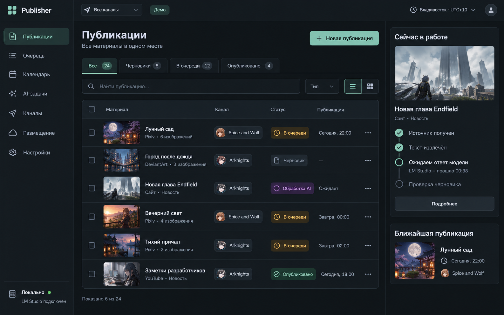
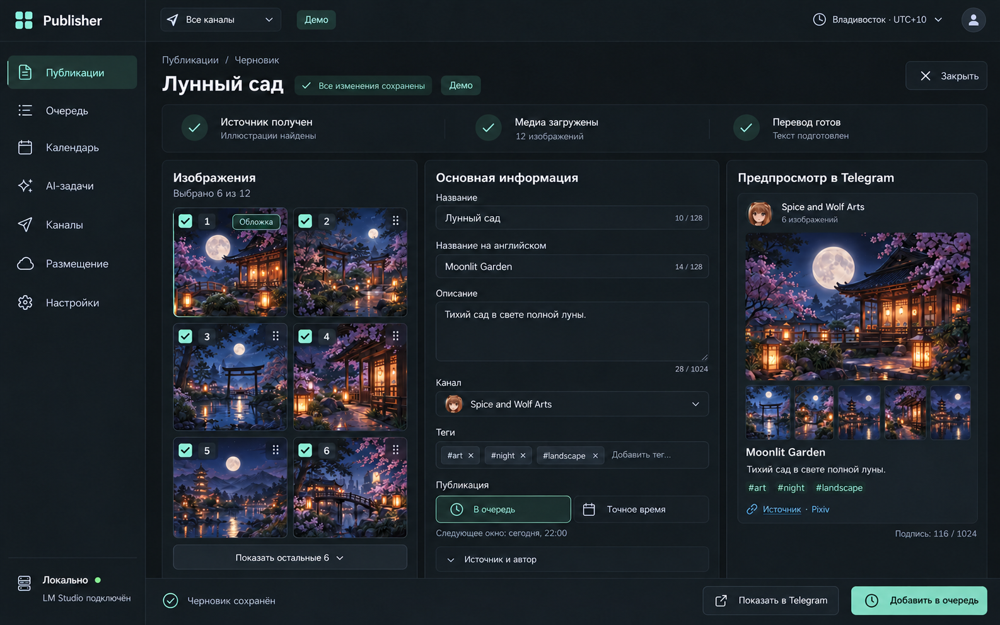
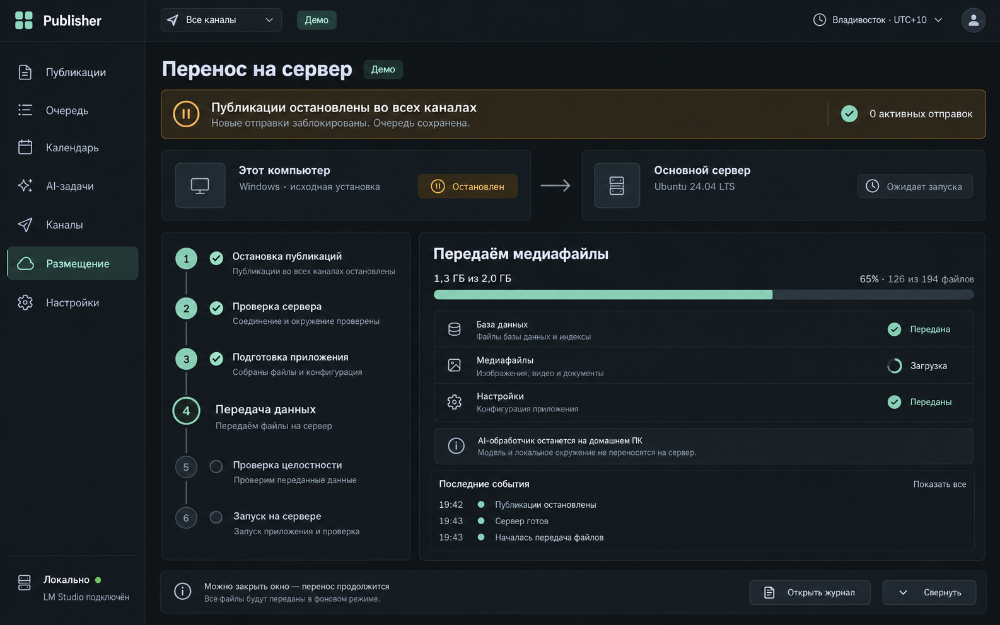
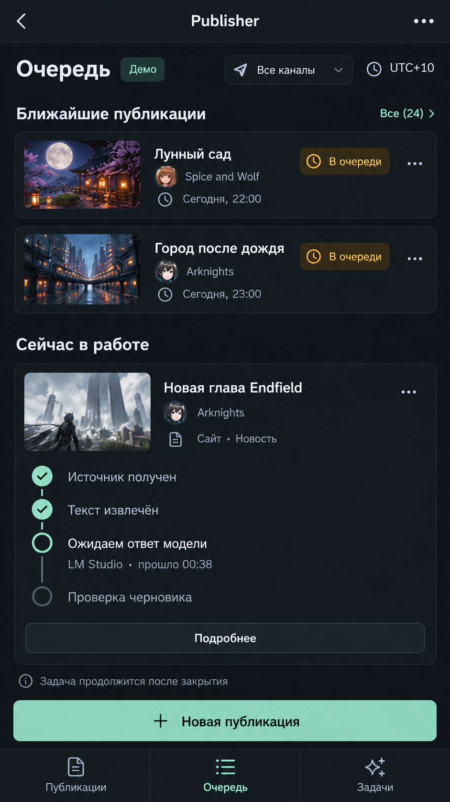
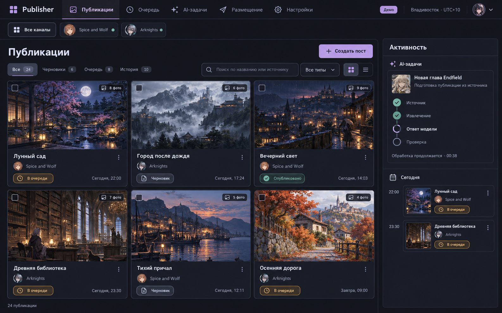
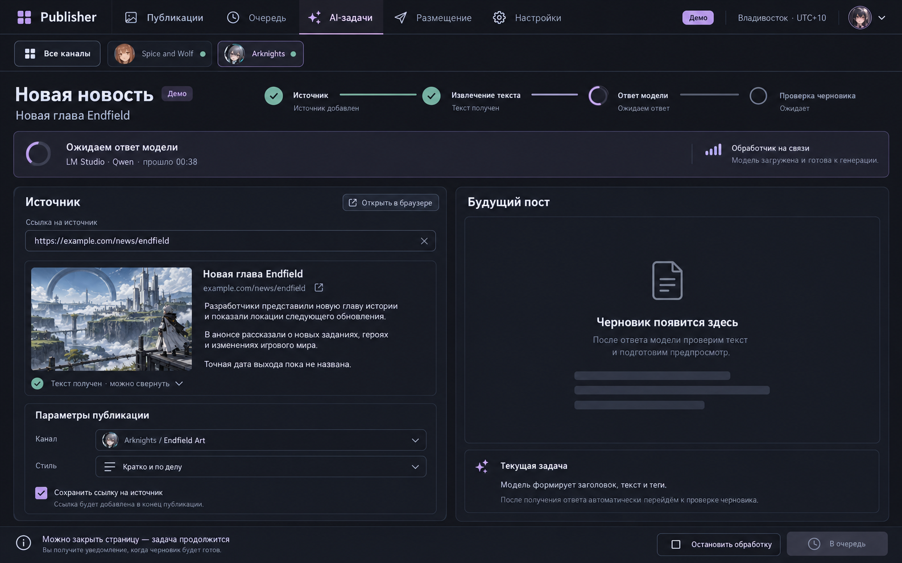
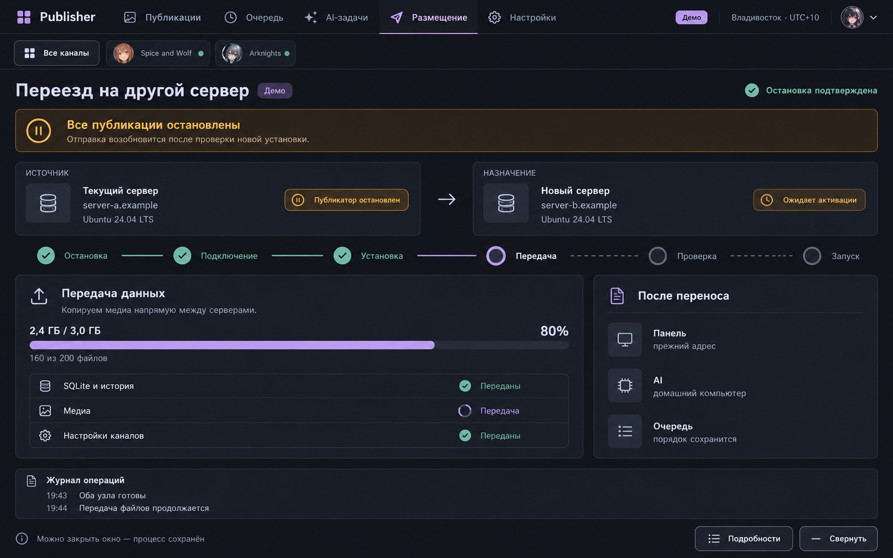
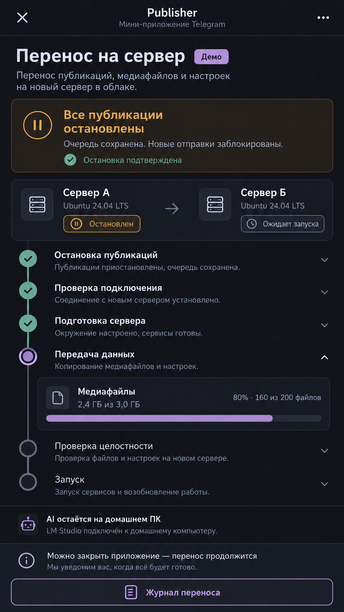

# Интерфейс Publisher и утверждённые визуальные ориентиры

Приложение к [ТЗ](web-platform-spec.md), версия 1.0 от 25 октября 2026 года. Пользователю понравилось предложенное оформление. Ниже приложены восемь ранее сгенерированных экранов; это изображения концепции, не скриншоты реализованного приложения.

## 1. Как использовать макеты

**Основная линия — «Графит»:** тёмный спокойный фон, мягкий мятный акцент, боковая навигация, компактная таблица, заметные статусы и редактор с предпросмотром. Из «Полночи» взять логику галереи, подробный экран ожидания AI и перенос сервер → сервер. Это единая система компонентов, не две разные программы. Отдельная лавандовая тема необязательна.

Воспроизводить композицию, плотность, иерархию и удобство, а не копировать PNG как фон интерфейса. Всё содержимое — реальные поля, кнопки, списки и данные API. Названия каналов/постов, числа, часы, пути, имена моделей и изображения на макетах демонстрационные; в production не подставлять их как данные.

Противоречие картинки и требований решается в пользу [ТЗ](web-platform-spec.md) и [контрактов](web-platform-contracts.md). Например, «Все публикации остановлены» выводится по подтверждённому состоянию, проценты вычисляются из переданных байтов, «Сохранено» — из ответа сервера. Статические счётчики длины и лимиты полей на изображениях не определяют реальные ограничения.

## 2. Визуальная система

| Элемент | Начальная спецификация |
| --- | --- |
| Фон | `#121619`, без белых вспышек при загрузке/переходах. |
| Боковая область / поверхности | `#151B1F`, `#1B2329`; диалоги чуть светлее основной поверхности. |
| Границы | `#303D46`, тонкие, без тяжёлых теней и постоянного свечения. |
| Основной текст | `#E1E7ED`; вторичный `#A8B5C2`. |
| Акцент | `#8AC7AF`, тёмный текст на заполненной основной кнопке. |
| Предупреждение / ошибка | Приглушённый янтарный `#E4B45F` / красный `#E18E8E`, обязательно текст и значок. |
| AI | Спокойный фиолетовый `#B3A2D5` допустим для отдельного статуса, не заменяет общий акцент. |
| Шрифт | Системный sans-serif или локально поставляемый шрифт с кириллицей. Основной текст 14–16 px, мобильный ввод минимум 16 px. |
| Ритм | Базовый шаг 4/8 px, отступы секций 16/24 px, радиусы 8–12 px. |
| Управление | Высота desktop controls около 40 px, touch targets минимум 44×44 CSS px. |

Цвета — стартовые tokens. Проверить контраст фактических комбинаций: обычный текст минимум 4.5:1, крупный текст/значимые границы минимум 3:1. При необходимости поправить token, сохранив характер макета. Положительный/ошибочный статус не различается одним цветом.

Никаких декоративных 3D-карточек, полноэкранных фоновых картинок, обязательных анимаций и огромных пустых отступов. Изображения публикаций могут быть яркими; окружающий интерфейс остаётся спокойным. Скелетоны/индикаторы малоконтрастные, без ослепляющего shimmer. Учитывать prefers-reduced-motion.

## 3. Каркас и адаптация

Desktop: левая навигация примерно 220–240 px; сверху контекст каналов, timezone и профиль; основной рабочий экран; справа при достаточной ширине — текущие операции/ближайшие публикации. Состояние размещения и AI видны, но не отнимают основное место.

Навигация: Публикации; Очередь; Календарь; AI-задачи; Каналы; Размещение; Настройки. История доступна фильтром публикаций и отдельными журналами; не создавать дублирующие разделы с разными источниками истины.

Адаптация по содержимому:

- От 1440 px: три колонки редактора, боковой блок активности при наличии места.
- 1024–1439 px: две области; предпросмотр в доступной вкладке/выдвигаемой панели, сокращённая навигация.
- 768–1023 px: компактная навигация; таблица теряет второстепенные колонки, а не важные действия.
- 360–767 px: одна колонка, редактор во вкладках «Медиа / Поля / Предпросмотр», нижняя навигация «Публикации / Очередь / Задачи / Ещё». Размещение и настройки доступны через «Ещё».

Не уменьшать desktop до нечитаемого масштаба. Не допускать горизонтального скролла всей страницы на 360 px; длинные URL/ошибки переносятся, таблицы при необходимости имеют локальный скролл. Sticky footer не закрывает последнее поле, клавиатуру и safe area.

Mini App использует тот же frontend и экранные сценарии. Интеграция: ready/expand, поддерживаемые safe-area/viewport API, BackButton, подтверждение выхода при неподтверждённом вводе, корректное открытие внешних ссылок. Не рисовать второй системный заголовок Telegram поверх настоящего. При обновлении viewport/появлении клавиатуры кнопка подтверждения остаётся доступной. Настройки темы клиента не должны внезапно включать светлый фон вместо согласованной тёмной темы.

## 4. Карта экранов

| UI ID | Маршрут клиента | Обязательное содержимое и действия |
| --- | --- | --- |
| UI-01 | `/publications` | Таблица/галерея, фильтры, поиск, состояния создания, массовый выбор, кнопка новой публикации, панель активности. |
| UI-02 | `/publications/new` | Тип «Изображения / Новость / Текст», ссылки/текст/загрузка, канал, теги, видимые ошибки полей, запуск операции. |
| UI-03 | `/publications/:id` | Альбом/поля/предпросмотр, autosave, версия/конфликт, безопасная постановка и точное время, возврат в черновик. |
| UI-04 | `/operations/:id` | Этапы импорта/AI/подготовки, ожидание, актуальность сигнала, результат, допустимые cancel/retry. |
| UI-05 | `/queue` | Очереди каналов, pause, прогноз/точное время, порядок, retry/отмена, неизвестные отправки. |
| UI-06 | `/calendar` | Недельный календарь и список по датам, timezone, фильтр, форма точного времени; различие прогноза и даты. |
| UI-07 | `/ai` | Workers, доступность, модели, очередь задач, смена модели и отдельное переназначение ожидающих задач. |
| UI-08 | `/channels` и `/:id` | Настройки канала, права, интервал, источник/дата статистики, статус, архивирование. |
| UI-09 | `/deployment` | Где приложение/AI, данные/копии, профили машин и три направления переноса. |
| UI-10 | `/deployment/migrations/:id` | План/подтверждение, общая остановка, текущий этап, реальные объёмы, журнал, безопасные действия по состоянию. |
| UI-11 | `/settings`, `/backups`, `/system` | Формы настроек, write-only секреты, backup/restore, здоровье с актуальностью проверок. |
| UI-12 | `/login`, `/setup`, `/moved` | Вход, доверенная первичная настройка, информация о перенесённой установке/новом адресе. |

Экраны без отдельного PNG обязаны использовать ту же систему компонентов. Полный дизайн новых разделов строится на этих правилах; отсутствие картинки не означает отсутствие функции.

## 5. Поведение основных компонентов

### 5.1. Публикации и редактор

Таблица — по умолчанию; галерея — пользовательский переключатель того же набора/фильтра. Поиск дебаунсится, URL хранит фильтры для возврата назад. Выделение строк относится к явному набору записей; при смене фильтра выбор очищается либо явно показывается внефильтровое выделение, без скрытого применения ко всей БД.

В редакторе «В очередь», «Точное время» и «Опубликовать сейчас» — разные понятные действия. Опасную немедленную отправку не делать скрытым эффектом сохранения. Подтверждение показывает канал и версию содержимого; кнопка блокируется на время принятия команды. Повтор клика/сети использует тот же idempotency key.

Выбранные кадры имеют checkbox, номер исходника и позицию; cover обозначает первый кадр, а не обещание фиксированной раскладки Telegram. При пустом выборе сохранять черновик разрешено, отправка недоступна с причиной. Отсутствующая миниатюра не удаляет кадр незаметно.

Поле ручной подписи отделено от автоматического шаблона. Видны лимиты итогового сообщения, усечения и источник. Ошибка валидации не стирает введённый текст. AI-результат для уже изменённого поля показывается как предложение, не внезапная замена.

### 5.2. Прогресс

Один Stepper/OperationPanel: выполненные этапы с галочкой, текущий с объяснением, будущие спокойные, ошибка с сохранённым пройденным путём. У текущего этапа — elapsed, последняя связь, measured progress при наличии. Для серверного ожидания писать «Ожидаем ответ источника», для worker offline — «Ждём домашний компьютер», для модели — «Модель готовит текст».

«Нет связи с панелью» не заменяет статус серверной задачи на failed. После reload восстанавливать OperationDTO. Длинная задача не блокирует всю навигацию; свёрнутый индикатор остаётся в панели активности. Успех ведёт к созданному черновику, ошибка — к месту исправления.

Текст «Можно закрыть окно — работа продолжится» относится к вкладке, а не выключению компьютера с controller. Если операция выполняется локально, рядом в подробностях указать, что ПК должен оставаться включённым.

### 5.3. Миграция

Настройка: источник/назначение, SSH/узел, каталоги, HTTPS, AI, политика просроченных постов → проверка → обзор плана и предупреждение → «Начать перенос». На телефоне тот же сценарий разбит на последовательные страницы без потери полей.

Во время выполнения постоянно видны общая остановка, обе машины и роли, текущий этап и безопасное следующее действие. «0 активных отправок» появляется после backend-проверки. «Остановлен» источника означает публикатор, не обязательно весь сервер; управляющая служба продолжает работу.

Показать как минимум: остановка → проверка → установка → снимок/передача → целостность → передача управления/запуск/адрес. Внутренние шаги протокола доступны в журнале. На переносе данных отображать фактические байты и файлы. Кнопка «Отмена» исчезает/меняется после activation commit в соответствии с контрактом; кнопка «Свернуть» никогда не отменяет.

Настройки пути поясняют машину. Нельзя предложить в облачном браузере «выбрать локальную БД» и подразумевать доступ к диску домашнего ПК без зарегистрированного host. Состояние «Ожидаем домашний компьютер» имеет отдельный экран/подсказку.

### 5.4. Обязательные состояния

Для каждого экрана предусмотрены loading, empty, partial data, error, no permission и maintenance. Для редактора дополнительно unsaved/offline/conflict; для assets — missing; для AI — waiting worker/model unavailable; для миграции — interrupted/waiting user/unknown activation/retired source. У всех ошибок есть сохранённые данные и доступное следующее действие.

Анимации не являются доказательством работы. Не выводить «LM Studio подключён» без последнего heartbeat; сохранять время/устаревание. Счётчики черновиков/очереди/истории согласованы с выбранными фильтрами и не подставляются из макета.

## 6. Приложенные изображения

Файлы сохранены в репозитории: `output/ui-concepts/2026-10-25/`. Это отобранные ранее сгенерированные варианты, включая исправленные выбор шести кадров и подпись о домашнем AI. Арт внутри экранов используется как демонстрационное содержимое макета, а не обязательные файлы продукта.

### A1. Графит — список публикаций

Ориентир для каркаса, таблицы, статусов, поиска и правой панели операций. UI-01.

### A2. Графит — редактор альбома

Ориентир для трёх областей, выбора/порядка, форм, autosave и предпросмотра. UI-03. Превью обязано соответствовать фактическому render plan; счётчики на иллюстрации не кодируются константами.

### A3. Графит — перенос с ПК на сервер

Ориентир для общей остановки, двух машин, stepper, передачи и журнала. UI-09/10. Подготовленная БД отображается как переданная только после проверки передачи соответствующего файла.

### A4. Графит — мобильная очередь

Ориентир для крупных touch targets, карточек, текущей AI-операции и нижней навигации. UI-05/04. Добавить доступ к остальным разделам через «Ещё», не ограничивать приложение тремя вкладками на рисунке.

### B1. Полночь — галерея публикаций

Ориентир для альтернативного вида UI-01: карточки медиа и панель активности. В основном продукте сохранить общую навигацию Графита; не менять её расположение только из-за переключения таблицы на галерею.

### B2. Полночь — подготовка новости и ожидание AI

Ориентир для источника, ещё не готового результата и честного состояния ожидания. UI-02/04. Поле «Стиль» на концепте не означает обязательную реализацию нескольких новых AI-стилей: показывать только реально поддерживаемые параметры; неподдерживаемый контрол убрать. Ссылку на источник сохранять по правилам текущей новости, не давать фиктивный переключатель.

### B3. Полночь — облако → облако

Ориентир для двух VPS, прямой передачи, состояния старого публикатора и ожидающего target. UI-10. «Панель: прежний адрес» возможно только при проверенном routing plan, не по умолчанию для любого IP.

### B4. Полночь — мобильный перенос

Ориентир для вертикального stepper и непрерывного предупреждения. UI-10. В основном оформлении применить tokens Графита. «AI остаётся на домашнем ПК» определяется выбранным планом и не описывается как работа на телефоне.

## 7. Визуальная приёмка

Реализующий агент делает реальные screenshots приложения на одинаковом детерминированном demo dataset в отдельном тестовом профиле: 1440×900, 1920×1080, 768×1024, 390×844 и 360×800 CSS px. Проверить основные экраны, длинный русский текст, пустые/ошибочные состояния и открытую мобильную клавиатуру.

Сравнивать с макетами по композиции, читаемости, плотности и иерархии, не по случайным деталям сгенерированного арта. Автоматические visual snapshots строятся по реализованному приложению после ручной проверки; бессмысленно требовать pixel-perfect совпадение с PNG генератора. Проверить табуляцию/focus, клавиатурную альтернативу drag-and-drop, отсутствие перекрытий, контраст и read-only maintenance.

Проверки Mini App на Telegram Android/iOS/Desktop фиксировать раздельно. Если конкретный клиент недоступен для реального испытания, записать это как непроверенное, а не заменить утверждением «адаптивная вёрстка означает поддержку всех клиентов».
