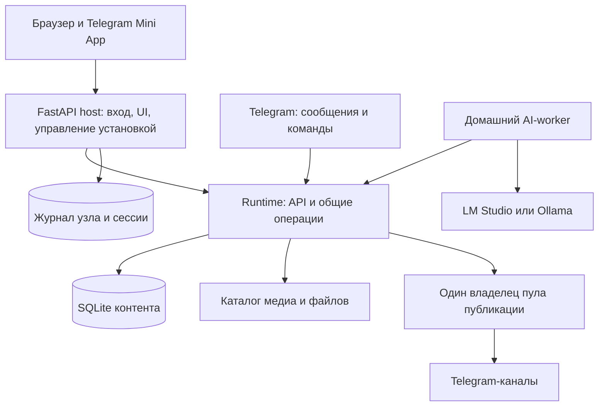

# Техническое задание: Edizora с веб-интерфейсом и Telegram Mini App

Версия 1.0 · 25 октября 2026 года · Задание для ИИ-агента, выполняющего реализацию.

## 1. Назначение и порядок чтения

Преобразовать существующий Telegram-бот в приложение управления публикациями: одна адаптивная веб-панель в браузере и Telegram Mini App, общий FastAPI API, существующая SQLite, сохранение работающих сценариев публикации и управляемый перенос между Windows-ПК и Ubuntu VPS. Это развитие продукта с переработкой архитектуры, а не косметическая замена кнопок.

Комплект нормативных документов:

1. **Этот файл** — объём работ, поведение продукта, архитектура и последовательность реализации.
2. [Контракты](web-platform-contracts.md) — сущности, состояния, HTTP API, авторизация, конкурентные изменения и фоновые операции.
3. [Перенос и эксплуатация](web-platform-migration.md) — остановка, снимок, передача управления, откат, установка и восстановление.
4. [Интерфейс и макеты](web-platform-design.md) — экранные сценарии, визуальные требования и восемь изображений.
5. [Приёмка](web-platform-acceptance.md) — проверяемые сценарии, доказательства и критерии завершения.
6. [Стартовое поручение агенту](web-platform-agent-brief.md) — инструкция для начала исполнения этого комплекта.

Последующие прямые указания владельца имеют приоритет. Внутри комплекта требования безопасности отправки и сохранности данных имеют приоритет над изображениями. Старые [архитектура UI](publication-ui-architecture.md), [архитектура переноса](deployment-migration-architecture.md) и roadmap — обоснование и история; предложения из них, не включённые сюда, не расширяют объём работ. При конфликте этих документов с настоящим ТЗ действует настоящее ТЗ.

«Обязательно» означает условие завершения всего задания. Этапы ниже — последовательность поставки, а не разрешение закончить на локальном MVP. Полноценный Mini App и все три направления переноса входят в итоговый результат. Макеты изображают вымышленные данные; их числа и названия не являются требованиями к рабочей БД.

## 2. Зафиксированные решения

| ID | Решение |
| --- | --- |
| BASE-01 | Один backend и одна модель данных для браузера, Mini App и сохранённых Telegram-команд. |
| BASE-02 | FastAPI; Python 3.12 как исходная поддерживаемая линия; SQLAlchemy/aiosqlite; SQLite на локальном диске активного узла. |
| BASE-03 | React + TypeScript + Vite; готовая сборка раздаётся сервером приложения. Node.js требуется для разработки/сборки, а не обычного запуска. |
| BASE-04 | Один активный узел приложения и один владелец пула публикации; внутри пула допустимы существующие параллельные задачи разных каналов. |
| BASE-05 | Локальная установка на Windows; первый серверный профиль — Ubuntu 24.04 LTS x86-64. Другие ОС/архитектуры не объявлять проверенными. |
| BASE-06 | Плановые переносы Windows → Ubuntu, Ubuntu → Windows, Ubuntu → Ubuntu. Это смена единственного владельца данных, а не синхронизация двух рабочих SQLite. |
| BASE-07 | После «Начать перенос» публикации всех каналов остановлены на всё время подготовки, копирования и проверки. Ручной запуск также заблокирован. |
| BASE-08 | На VPS могут работать API, UI и подготовленная очередь; AI-worker и LM Studio могут оставаться дома. Переезд приложения не означает перенос весов моделей. |
| BASE-09 | Все длительные действия имеют сохраняемый прогресс с понятными этапами; закрытие браузера не отменяет принятую задачу. |
| BASE-10 | Основное оформление — тёмный «Графит», таблица и переключаемая галерея. «Полночь» — дополнительный визуальный референс, не второй независимый интерфейс. |

Зафиксировать совместимые версии зависимостей в lock-файлах после проверки при реализации. Не подставлять произвольные «самые новые» версии в рабочий проект. Существующий aiohttp сохраняется для HTTP-клиентов; переход на FastAPI не требует переписывать все сетевые транспорты.

## 3. Реальное исходное состояние

Опора — текущая рабочая папка, включая незакоммиченные изменения и новые файлы. Нельзя начинать с чистого старого HEAD и тем самым потерять уже сделанные функции. При подготовке этого ТЗ приложение, внешние публикации и миграции рабочей БД не запускались.

| Текущая часть | Что делать |
| --- | --- |
| `app/bot/router.py`, `news_ui.py`, `album_ui.py`, `model_ui.py` | Сохранить пользовательские сценарии; перенести правила и прямые записи в общие операции. Telegram становится клиентом этих операций. |
| `app/services/job_service.py`, `album_service.py`, `app/domain/album.py` | Переиспользовать правила очереди, альбомов, дублей и состояний; добавить сквозные версии и общий запрет отправки. |
| `caption_service.py`, `news_render_service.py`, `preview_service.py` | Выделить чистую сборку представления публикации; HTTP GET предпросмотра не запускает перевод и не пишет в БД. |
| `app/queue/worker.py`, `publisher_service.py` | Сохранить отправку и обработку неопределённого результата; добавить журнал попыток и разрешение на отправку. |
| `app/news/api.py` | Это aiohttp API домашнего worker, а не API панели. Перенести его контракт в общий сервер с отдельными правами; предусмотреть переход старого worker. |
| `app/db/models.py`, `session.py` | Сохранить таблицы/ID/историю; заменить ручные добавления колонок управляемыми последовательными миграциями. |
| `app/bootstrap.py` | Разделить сборку зависимостей, миграции схемы, импорт настроек, polling и запуск исполнителей. Пассивный запуск не имеет побочных эффектов. |
| `app/runtime.py`, `app/local.py` | Использовать опыт локальной блокировки, supervision и SQLite Backup API; расширить до управляемых ролей узла. |
| `app/news/home_runtime.py`, `model_selection.py` | Добавить постоянную регистрацию worker, каталог моделей, удалённый выбор и задачи перевода названий. |
| `deploy/`, Dockerfile, docker-compose.yml | Сохранить пригодные части; нынешний update-скрипт не считать готовым установщиком или протоколом переноса. |

Известные ограничения, которые надо явно обработать:

- Значимая часть правил находится в Telegram-обработчиках. Нельзя дублировать её во фронтенде или FastAPI routes.
- `force_publish` сейчас обходит паузу канала. Поэтому пауза канала не подходит для миграции.
- `MemoryStorage` не сохраняет незавершённый чат-мастер. Принятый материал должен стать постоянным черновиком/операцией.
- `media_items` хранит результаты отправки, а не полноценный каталог файлов черновика. Нужен отдельный каталог.
- Выбор модели хранится в `storage/lmstudio-model.json` и связан с AI-адресом; нельзя слепо превратить localhost домашнего ПК в localhost VPS.
- `_sync_channels()` сейчас может переписать настройки из конфигурации при старте. Настройки, изменённые в UI, должны переживать перезапуск.
- Есть старые альбомы без полного каталога и исторические пути к уже удалённым файлам. Это состояние надо сохранить и корректно показывать.
- Исторические количества заданий из старых документов не фиксируют сегодняшнее содержимое БД. Перед реализацией создать актуальный отчёт на согласованной копии.

## 4. Границы выпуска

Обязательны: импорт существующих источников, создание и восстановление черновиков, альбомы, редактирование текста/тегов/канала, предварительный просмотр, очередь, точные даты, календарное представление, история, каналы, AI, настройки, авторизация, Mini App, прогресс, резервное копирование, три направления переноса и Ubuntu-установщик.

Сохранить Telegram-приём ссылок, текста, пересланных постов и альбомов, уведомления и действующие команды. Добавить кнопку открытия панели. Не удалять чат-интерфейс до подтверждённого функционального соответствия; существующие команды в итоговом выпуске продолжают вызывать общие операции.

Не входят: покупка/создание VPS через API провайдера, оплата хостинга, автоматический аварийный failover, active-active, PostgreSQL как обязательная замена, SaaS для разных организаций, сложная ролевая система, RSS-агрегатор, OCR/ASR, GPU-развёртывание моделей, редактор обрезки изображений, изменение уже опубликованных сообщений, полноценная история произвольных правок, отдельные нативные приложения. Функции из roadmap не добавлять только потому, что они там перечислены.

## 5. Архитектура исполнения

### 5.1. Границы компонентов

1. **Web client**: формы, навигация, отображение данных, локальное состояние несохранённого ввода. Не вычисляет разрешение публикации и не работает с SQLite/Telegram/LM Studio напрямую.
2. **Host/controller**: отдельный долгоживущий процесс управления установкой. Содержит FastAPI entrypoint, статическую сборку, сессии, запуск/остановку runtime, API размещения и отдельный журнал миграций. Не прекращается вместе с публикатором.
3. **Application runtime**: один процесс, обслуживающий прикладные операции/API, SQLite, очередь, приём Telegram и фоновые операции. Внутренний HTTP/RPC доступен только controller по локальному защищённому каналу. Внутренний контекст пользователя подписан/аутентифицирован, а права на данные проверяются runtime.
4. **Application services**: общие команды для HTTP и Telegram, транзакции, проверки, формирование результатов. Не зависят от объектов Message/CallbackQuery/FastAPI Request.
5. **Edizora**: единственный путь отправки материалов в целевые каналы. Все входы, включая старые команды и аварийные повторы, проходят общий gate.
6. **AI-worker**: отдельный исполнитель дома или на выбранной машине; обращается к серверу исходящими запросами. Не получает административных прав и bot token.

Внешний клиент видит один origin и один API `/api/v1`; разделение процессов не должно появляться в обычных формах. Controller может проксировать прикладные запросы runtime. Его собственный журнал и сессии находятся вне переносимой БД контента: отображение прогресса не нарушает запрет записей в снимок.

Стрелка AI → runtime означает исходящие запросы worker за заданиями/передачей результатов; runtime не открывает входящий порт на домашнем ПК. Host управляет жизненным циклом runtime, но не отправляет публикации в обход него.

При недоступном runtime controller продолжает отдавать оболочку, состояние установки и уже авторизованному администратору — прогресс миграции. При невозможности заново проверить личность новые входы закрыты, а не разрешены по отсутствию runtime. Перенос не обязан сохранять браузерную сессию между машинами: на назначении допустим повторный вход.

Рекомендуемые новые области: `app/application/`, `app/api/`, `app/operations/`, `app/storage/`, `app/host/`, `app/deployment/`, `frontend/`, `migrations/`. Это границы ответственности, а не требование немедленно переместить каждый старый файл. Избегать большого перемещения кода до регрессионной проверки.

### 5.2. Запуск и владение

- Один host на установку; один runtime с правом фоновой работы. Запуск Uvicorn с несколькими workers для этого профиля запрещён; dev reload не запускает реальные отправки.
- Роли узла: `active`, `standby`, `retired`, `recovery_required`. Обслуживание — отдельное сохраняемое состояние текущего владельца.
- `standby`: проверка/чтение; без polling, восстановления очереди, AI lease, статистики, удаления файлов и публикаций.
- `retired`: информация о новом адресе и при необходимости отдельный домашний AI-worker; никакого автоматического возвращения к роли active.
- Отсутствующий/повреждённый манифест существующей установки означает `recovery_required`. Копия БД не получает права запуска автоматически.
- На старте host сверяет node ID, system ID, поколение активации, манифест данных, состояние миграции и локальную блокировку. Сначала проверка, затем исполнители.
- Локальный запуск открывает браузер и оставляет процессы работающими после закрытия вкладки. Сон/выключение ПК останавливает локальную обработку; UI не обещает обратного.

## 6. Публикации и редакторы

### PUB-01. Общий список

Публикации и ещё не завершённые операции создания видны в едином списке. Поиск по названию/источнику/тегам, фильтры по каналу, типу, статусу и периоду; сортировка; серверная пагинация; таблица/галерея; сохранение выбранного вида. Отдельно помечать «готовится материал» и существующий Job, не создавать два визуальных поста после завершения одной операции.

Показывать миниатюру/заглушку, название, источник, канал, статус, количество выбранных кадров, точное или прогнозируемое время, ошибку при наличии. Из карточки доступны только разрешённые сервером действия. У каждого недоступного действия есть понятная причина.

### PUB-02. Импорт изображений

Форма: одна/несколько ссылок, канал, пользовательские теги, необязательный выбор страниц. Поддержать Pixiv, DeviantArt, прямые изображения в объёме нынешних providers. Для каждой ссылки — отдельный результат, общий прогресс и независимая ошибка. Падение одной ссылки не теряет успешные черновики.

Сохранять исходные метаданные, нормализованный URL, ID источника, автора, дату, исходные теги и полный полученный каталог. Проверять ограничения и дубли до отправки. Дубль показывать со ссылкой на существующее задание/публикацию; осознанный повтор требует отдельной команды и не обходится обычным retry.

### PUB-03. Редактор альбома

Три области desktop: изображения / поля / предпросмотр. На телефоне — вкладки. Кадры имеют устойчивый ID и неизменный исходный номер, выбор и позиция — отдельные значения. Поддержать включение/исключение, drag-and-drop, «сделать первым», кнопки перемещения для клавиатуры/телефона, ввод номеров, первые допустимые кадры, исходный выбор, очистку и просмотр только выбранных.

Счётчики и предпросмотр соответствуют сохранённому выбору. Пустой выбор можно сохранить в черновике, но нельзя отправить/поставить в очередь. Существующие лимиты и разбиение на Telegram-группы сохранить; не вводить произвольный запрет всех альбомов более 10 кадров, если существующая настройка разрешает разбиение.

Поля: оригинальное название, перевод, описание, пользовательские/исходные теги, канал, ручная подпись либо автоматическое оформление, режим публикации. При изменении исходного названия прежний автоматический перевод помечается устаревшим; AI не перезаписывает ручной перевод без применения результата пользователем.

### PUB-04. Новости

Источники: публичная статья, YouTube с доступными субтитрами, публичный Telegram-пост, пересланный боту материал, ручной текст. Ограничения закрытых Telegram-ссылок и отсутствующих субтитров сохранить и объяснять. Не обещать скачивание/распознавание любого видео.

Создание возвращает операцию. Показывать источник, модель, worker, этапы, предупреждения, использованные факты и итоговый редактируемый текст. Для источника показывать сохранённые метаданные/доступный фрагмент: полный текст статьи не обязан оказаться на VPS, если существующий worker его туда не передаёт. Черновик не публикуется автоматически после AI.

Сохранить добавление/удаление/очистку/замену медиа. При неудачной замене прежний набор остаётся до атомарного подтверждения нового. Загрузка из браузера получает media ID, лимиты и проверку типа; путь на компьютере клиента не используется как серверный путь.

### PUB-05. Сохранение и конкурентные правки

Автосохранение после короткой паузы ввода, явные состояния «Есть изменения», «Сохраняем», «Сохранено», «Нет связи», «Конфликт». «Сохранено» показывать только после подтверждения сервера. Перед постановкой в очередь дождаться сохранения той же версии и повторно проверить возможность действия.

Вкладки, Telegram и AI используют одну версию записи. При конфликте не затирать ввод: показать текущую серверную версию и локальные правки, предложить обновить/применить выбранные поля к новой версии. Нельзя бесконечно автоматически повторять устаревший PATCH.

Изменения содержимого альбома/новости разрешены в черновике. Для ожидающей очереди сохранить нынешние безопасные правки тегов, подписи и расписания. Для полного редактирования добавить «Вернуть в черновик»: атомарно снять не начавшееся задание с очереди и сбросить force; если worker уже забрал его — конфликт. Активную и завершённую отправку редактировать нельзя.

### PUB-06. Предпросмотр и готовность

Один серверный render plan используется браузером, проверкой в личном Telegram-чате и отправкой в канал. В нём: окончательный текст/форматирование, выбранные медиа, порядок, число Telegram-сообщений, предупреждения об усечении и отдельном текстовом сообщении. Нельзя показывать одну подпись, а собирать другую при отправке.

Перед облачной автономной публикацией необходимые медиа и результаты AI должны быть доступны активному узлу. Явное состояние readiness отделено от состояния очереди; незавершённая подготовка показывает причину ожидания. Перевод не должен впервые запускаться в момент отправки на VPS с выключенным домашним ПК. Настроенный резервный перевод или отправка без перевода допустимы только по сохранённой явной политике.

GET предпросмотра — чтение. Подготовка/обновление медиа и перевода — POST с operation ID. Проверка в личном Telegram-чате — отдельное действие, не автоматический эффект открытия редактора. Во время миграции она также запрещена, чтобы не создавать новые сетевые отправки.

## 7. Очередь, календарь и история

### QUE-01. Семантика очереди

Сохранить независимые очереди каналов, позиции, интервал, паузу, блокировку одного активного задания в канале, `next_attempt_at` и лимит попыток. Переупорядочивание выполняется атомарно для одного канала и версии очереди. Массовые команды действуют на конкретный список ID/версий; расширение фильтра не должно незаметно затронуть новые записи.

«Опубликовать сейчас» — отдельная явная команда: обходит пользовательскую паузу канала, интервал и прежнее точное время, но **не** общий запрет, выключенный канал, неопределённую отправку, неподготовленные данные или занятый канал. Ручная успешная отправка запускает обычный интервальный таймер заново.

Общая пользовательская кнопка «Остановить публикации» использует отдельную причину gate и корректное завершение начатых отправок. «Возобновить» снимает только эту причину; не снимает блокировку миграции/восстановления. В отличие от паузы одного канала общая остановка не обходится force.

Точное время означает «не раньше». Такие задания не занимают позицию обычной очереди и не двигают её интервальный таймер, но ждут свободный канал. Снятие точной даты возвращает ожидающее задание в конец обычной очереди. Изменение интервала учитывает последнюю успешную публикацию; перенос машины не пересчитывает его от момента установки.

### QUE-02. Календарь

Обязательны список по датам и недельное представление, выбор даты/времени в форме, фильтр каналов, визуальное различие точного времени и прогноза. Перетаскивание в календаре и сложное месячное планирование необязательны. Использовать UTC в хранилище и IANA timezone в настройках; исходный часовой пояс — `Asia/Vladivostok`.

Просроченные задания показывать отдельно с причиной задержки. Правила после сна/миграции заданы в документе переноса. Не отправлять накопившиеся точные задания плотной серией без выбранной политики.

### QUE-03. Повторы, отмена, неизвестный результат

Отмена ожидающего задания немедленна; отмена активного — запрос безопасной остановки. UI не обещает отозвать уже отправленное сообщение. Автоматический/массовый retry не затрагивает `uncertain_publish` или частично подтверждённые отправки.

Для неизвестного результата показать канал, время, известные message ID/части и предложение проверить канал. Разрешить записать результат ручной проверки и отдельно подтвердить повтор с предупреждением о дубле. Не считать отсутствие записи Publication доказательством отсутствия сообщения в Telegram.

### QUE-04. История

Просмотр опубликованных, отменённых и ошибочных заданий; фактические времена, канал, ссылки/message ID, журнал действий, использованная модель, ошибки без секретов. Недоступное историческое изображение имеет заглушку, а не бесконечную загрузку. История и исходные ID сохраняются при обновлении и всех переносах.

## 8. Каналы, AI и настройки

### CHN-01. Каналы

Список и карточка: название, alias, Telegram ID, права бота и время их проверки, доступность, включение, пауза, основной канал, интервал, режим photo/document/auto, шаблон подписи, теги по умолчанию, статистика подписчиков и дата обновления. Добавление/изменение канала проходит проверку конфигурации и разрешений; ошибки сети не подменяют известные данные нулём.

Замена Telegram ID у канала с историей не должна переадресовывать её новому каналу. В первой версии создать новый канал/явную управляемую замену с отдельным подтверждением, а прежний выключить. Удаление канала с историей — архивирование. Существующие ID и связи не удалять.

SQLite — источник изменяемых настроек каналов. TOML/ENV — первоначальное заполнение и инфраструктура/секреты. Повторный импорт конфигурации — явное действие с показом различий; перезапуск ничего не откатывает.

### AI-01. Домашний исполнитель

Постоянная регистрация worker, отзыв, последняя связь, тип провайдера LM Studio/Ollama, машина, каталог доступных текстовых моделей и выбранная модель. Worker использует только исходящее соединение; LM Studio слушает локально и не публикуется в интернет.

Смена модели действует на новые задачи. У ожидающих старых задач — отдельное переназначение с перечислением затронутых ID. Уже начавшаяся задача сохраняет модель/параметры попытки. Удалённый каталог нельзя выдавать за локальный запрос к VPS. Embedding-модели не предлагаются как модели написания текста.

Новостная обработка и перевод названия доступны через общий протокол worker. Недоступный worker означает ожидание, а не расходование попыток. Поздние ответы после отмены, новой lease или переезда отвергаются. Дома могут остаться веса моделей и локальный кэш; подготовленные материалы остаются на активном сервере.

### SET-01. Настройки и диагностика

Разделы: общие/часовой пояс, источники, оформление и лимиты, AI, доступ, размещение, резервные копии, состояние. Не показывать пользователю внутренние имена переменных вместо понятных подписей. Продвинутые пути/порты — раскрываемый блок.

Секреты показываются как «задан/не задан» с заменой и проверкой, без возврата исходного значения в API. Изменение токена бота требует повторной проверки идентичности бота; не применять несовместимую замену автоматически к старой истории/file ID. Страница состояния разделяет здоровье приложения, Telegram, источников, worker и AI; показывает актуальность данных.

## 9. Фоновые операции и прогресс

PROG-01: общая модель Operation для импорта, загрузки, подготовки/перевода, AI, резервного копирования и миграции. Backend хранит этап, состояние, время начала/последнего сигнала, измеримый объём, результат и доступные действия. Бизнес-операции — в SQLite контента; миграции — в журнале controller, с объединённым представлением для UI.

Различать: ожидание очереди, выполнение, ожидание сервера, ожидание AI, необходимость действия пользователя, отмена, ошибка, успех. Для известного размера передачи показывать байты/файлы и процент этапа; для ожидания модели — причину и прошедшее время, без выдуманных 73%. Оценку времени подписывать как прогноз.

В первой версии достаточно устойчивого polling: активная открытая операция раз в 2 секунды, фоновый список раз в 10 секунд, ограниченный backoff до 30 секунд при ошибках. После восстановления сети — немедленная сверка. SSE допустим как улучшение поверх того же сохраняемого контракта; потеря push-соединения не теряет состояние.

Операция запускается сервером после подтверждения принятия; не использовать неперсистентный FastAPI BackgroundTasks как единственный механизм надёжной работы. После перезапуска безопасные этапы продолжаются/повторяются по сохранённым контрольным точкам. Сетевые действия с неопределённым результатом требуют сверки, а не слепого повтора.

## 10. Данные, доступ и перенос

DATA-01: версионированные миграции на копиях существующей SQLite, обязательная копия до первого обновления, сохранение прежних ID/связей/истории/JSON, проверка старых форматов. Подробная схема — в [контрактах](web-platform-contracts.md).

DATA-02: каталог медиа с относительными ключами внутри data root, отдельные оригиналы/подготовленные файлы/миниатюры, pin файлов активных черновиков и очереди. Активная БД не находится на сетевом/синхронизируемом диске. Предлагать перенос из текущей OneDrive-папки в управляемую локальную папку, а не молча перемещать рабочие данные.

SEC-01: локальная одноразовая сессия запуска, отдельный вход в обычном внешнем браузере, проверка Telegram initData для Mini App, allowlist администраторов, разделённые полномочия worker/controller/пользователя, защита от CSRF/XSS/SSRF, аутентификация выдачи медиа. Подробности обязательны по контрактам.

MIG-01: мастер переноса не является обычным switch, который мгновенно меняет адрес БД. Он показывает план, предупреждение, подтверждённую общую остановку, подготовку, реальную передачу, проверку и единоличную активацию. Все три направления, обратный перенос актуальных данных, восстановление прогресса и отказы при неопределённости описаны в [протоколе](web-platform-migration.md).

## 11. Качество и эксплуатационные требования

- Интерфейс на русском, без необходимости знать синтаксис Telegram-команд. Ошибки объясняют причину и допустимое следующее действие; технические подробности раскрываются отдельно.
- Доступность с клавиатуры, читаемый контраст, focus, подписи полей/иконок, отсутствие зависимости от одного цвета; мобильные действия не требуют hover.
- При 10 000 заданиях и странице 50 записей: p95 чтения списка ≤ 500 мс, локального сохранения ≤ 700 мс на согласованном тестовом стенде 2 vCPU / 4 ГБ / SSD, без внешних вызовов. Зафиксировать фактический стенд и замеры. Длительные внешние действия возвращают operation ID обычно ≤ 1 секунды.
- Подгрузка миниатюр по видимой области; полный оригинал не нужен для загрузки таблицы. Пагинация/индексы обязательны, полный JSON всех заданий в браузер не выгружать.
- Структурированные логи: request ID, operation ID, job ID, migration ID, node ID; секреты удаляются и из traceback. Срок хранения и ротация ограничены. Журналы активации не чистятся обычной уборкой.
- Liveness отличается от readiness: доступная страница не означает, что публикации разрешены. Диагностика не отправляет тестовый пост в рабочий канал.
- Недоступная сеть, worker, источник или Telegram не сбрасывают сохранённый ввод и не превращают нулевой ответ в успешную операцию.
- В production нет фиктивных демонстрационных записей, таймеров прогресса и кнопок, которые лишь показывают toast без серверного действия.

## 12. Последовательность реализации

| Этап | Результат и условие перехода |
| --- | --- |
| S0 — инвентаризация | Снимок текущего дерева/данных, реестр функций и зависимостей, безопасный тестовый профиль, исходные тесты и отчёт о существующих ошибках. Не менять рабочую БД. |
| S1 — данные и общие операции | Версионированная схема, совместимое чтение старых альбомов, общий слой команд, версии записей, render plan и политика настроек. Регрессии старых сценариев проходят. |
| S2 — управление исполнением | Host/runtime, роли узла, единый gate, журнал отправок, durable inbox, постоянные операции и восстановление. Доказаны запрет ручного обхода и отсутствие двойного worker. |
| S3 — API и медиа | Авторизация, контракты OpenAPI, каталог/выдача файлов, CRUD черновиков, очередь, каналы, AI. Контрактные и интеграционные проверки на SQLite-копиях. |
| S4 — локальная веб-панель | Все ежедневные сценарии, адаптивность, сохранение/конфликты, прогресс, календарь, история, диагностика; визуальная проверка по макетам. |
| S5 — удалённый доступ и Mini App | Обычный HTTPS-вход и Telegram-вход, меню бота, мобильные сценарии, зарегистрированный домашний worker, готовая очередь без AI дома. |
| S6 — переносимый выпуск | Проверяемый export/import, медиа-манифест, пассивная установка, резервные копии/restore, Ubuntu 24.04 установщик и Windows host. |
| S7 — мастер миграции | Все три направления, журнал, запрет старого запуска, потерянный ACK активации, откат до передачи права и обратный перенос после неё. |
| S8 — итоговая приёмка | Полная матрица, чистая установка, обновление с текущей БД-копии, тестовый Telegram-канал, реальные разрешённые стенды и итоговый отчёт. |

Каждый этап выполняется небольшими проверяемыми изменениями. Допускается объединять связанные изменения, но нельзя откладывать версии/медиа/gate до конца UI: они определяют его корректность. Перед началом следующего этапа обновлять журнал исполнения с перечнем выполненных требований, проверок и оставшихся ограничений.

## 13. Правила работы реализующего агента

1. Читать комплект целиком; затем обследовать актуальное дерево, AGENTS.md и тесты. Проверить, не изменился ли проект после даты ТЗ.
2. Не откатывать и не стирать чужие незакоммиченные изменения. Снимок включает новые файлы; приватные данные/секреты не включать в публичные коммиты или отчёт.
3. Разрабатывать на копии данных. Не запускать штатный launcher с production-токеном ради smoke-test. Все автоматические тесты используют подменённый Telegram и изолированные каталоги.
4. Не смешивать перенос, обновление версии приложения и смену бота в одну операцию. Нельзя объявлять старый неуправляемый запуск безопасным резервом после активации нового.
5. Сохранять обратную совместимость до проверенного перехода. Сначала общая операция, затем HTTP/Telegram адаптеры; не копировать бизнес-логику в UI.
6. Не останавливаться после красивых статических экранов. Итог — реальное приложение с работающими контрактами, миграциями и установкой.
7. Рутинные технические решения в рамках ТЗ принимать самостоятельно и фиксировать. Существенное изменение согласованного поведения/границ — описать с последствиями; не скрывать под «рефакторингом».
8. Не запрашивать боевые секреты заранее. При необходимости внешнего теста сначала подготовить сборку, план и точные данные, которые действительно нужны. Невыполненную внешнюю проверку отмечать явно.

## 14. Результат, который должен быть передан владельцу

Исходники и lock-файлы; готовая frontend-сборка в релизе; миграции и отчёт сравнения данных; схемы API; Windows launcher/host и Ubuntu-установщик; инструкции локального/облачного запуска, Mini App, worker, backup/restore и переноса; обновлённые настройки-примеры без секретов; снимки реализованных экранов; результаты автоматических/ручных проверок; список оставшихся ограничений.

Выпуск считается завершённым, когда выполнены обязательные требования комплекта и [критерии приёмки](web-platform-acceptance.md). Отсутствие сервера для внешней проверки не делает направление «облако → облако» проверенным; агент должен честно разделить реализованное, проверенное на стенде и ещё не проверенное на реальной инфраструктуре.
